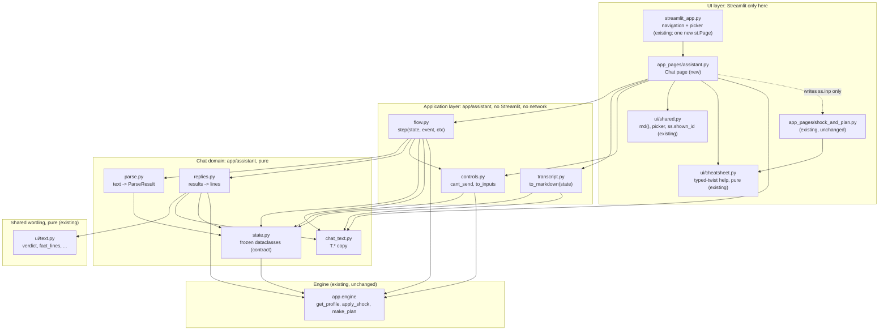
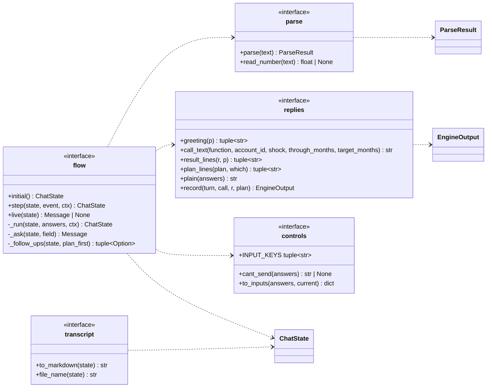
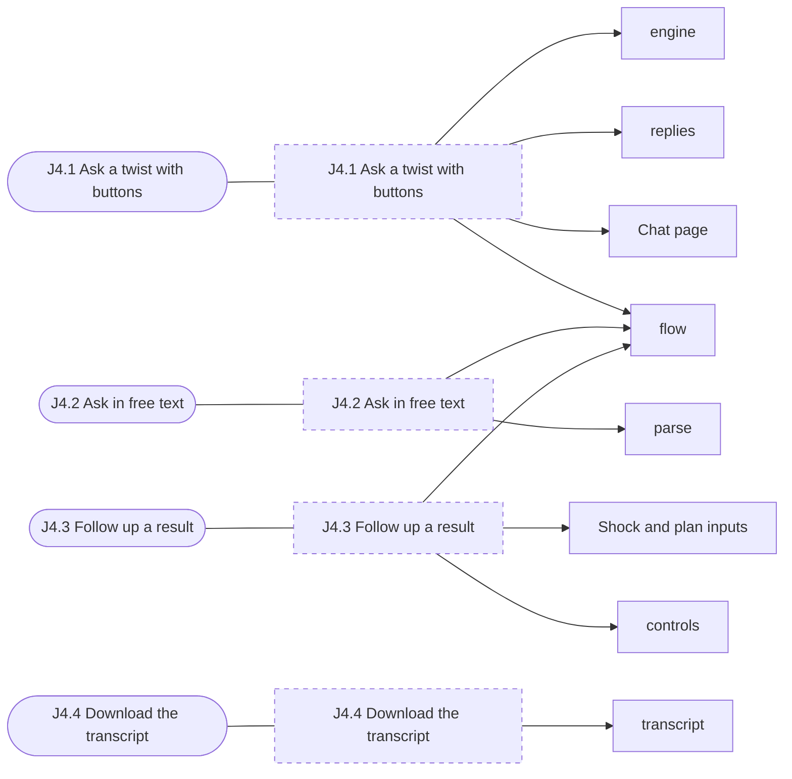
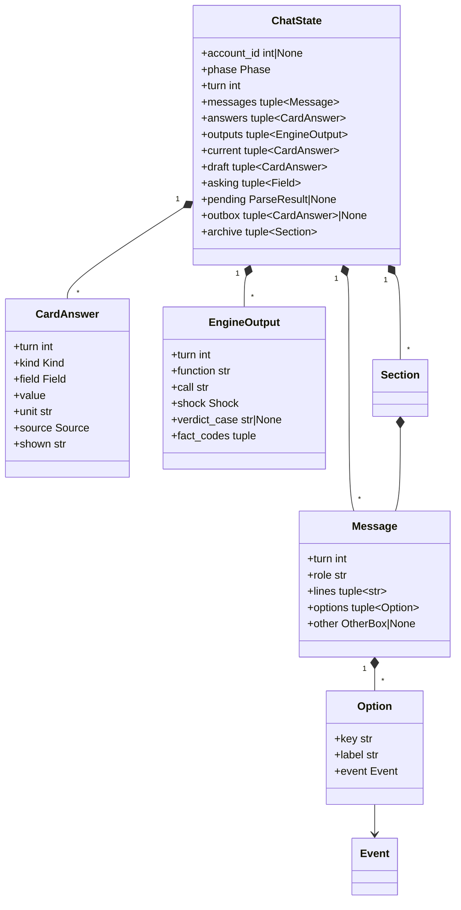
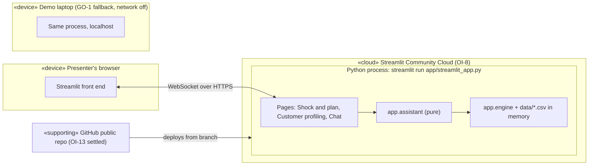

# Architecture: J4 Ask the assistant (guided chat)

Status: proposed, 2026-11-07. Author: the architecture lead (elaboration). Decisions are in [ADR 0002 to 0005](../adr/README.md). The build plan, the test map and the work packages are in [`j4_chat_build.md`](j4_chat_build.md).

Inputs: [J4 summary](../inception/use_cases.md#j4-ask-the-assistant), [J4.1 to J4.4](../inception/use_cases_chat.md), [BR-14 to BR-18 and RU-15 to RU-22](../inception/requirements.md), [chat MVP and AC-1 to AC-10](../inception/scope.md#chat-assistant-j4-mvp-and-stretch), [chat state machine](../design/ux/flows.md#4-chat-state-machine-j4), [wireframes T1 to T6](../design/ux/wireframes.md#t-chat-page-j4), [chat copy](../design/ux/copy.md#10-chat-t), [parser](../design/ux/chat_parser.md), [engine contract](../engine_contract.md), [ADR 0001](../adr/0001-engine-shock-semantics.md).

## 1. What kind of system this is

- **System type: decision support** over a read-only, in-memory dataset. The chat adds no data and no transactions. It is a second front end that turns a twist card into engine calls and reads the results back in fixed sentences (BR-14, BR-16). Every number comes from the engine (RU-15).
- **Reference architecture:** the conversational-agent pipeline (understand → manage dialogue → act → generate reply). It is the checklist that showed which parts we need: **understanding** is `parse.py`, the **dialogue manager** is `flow.py`, **acting** is the engine, and **reply generation** is `replies.py` plus `ui/text.py`. The usual language-model step is removed on purpose (ADR 0002). The second candidate, a plain form wizard, has no free-text path and no transcript, so it fails BR-14 and BR-17.
- **Pattern: functional core with an imperative shell.** A pure state machine `step(state, event) -> state` sits behind a thin Streamlit page (ADR 0003). It beats MVC with callbacks that mutate session state, because the state machine can be tested without Streamlit across all 4,500 accounts, the same way `ui/text.py` already is. Inside the core, the split is the default layered one: page (UI) / flow (application) / state, parse, replies, controls, transcript (domain of the chat) / engine (existing domain, unchanged).

## 2. Design model: Software System Architecture



**Dependency rules.** These are checked by `test_chat_imports.py` ([build §2](j4_chat_build.md#2-test-strategy)).

| Rule | Check |
| :-- | :-- |
| D1. Nothing under `app/assistant/`, `app/engine/`, `app/ui/text.py`, `app/ui/cheatsheet.py` imports `streamlit` | AST scan |
| D2. Nothing under `app/` imports `requests`, `httpx`, `urllib`, `http.client`, `aiohttp`, `socket`, `anthropic` or `openai` | AST scan (AC-10) |
| D3. `app/assistant/` imports only the standard library, `app.engine`, `app.ui.text` and itself | AST allow-list |
| D4. `app/engine/` never imports `app.assistant` or `app.ui` | AST scan |
| D5. Only `app_pages/assistant.py` and the tests import `app.assistant`. The page may also import `app.ui.shared`, `app.ui.text` and `app.ui.cheatsheet` | AST scan |
| D6. The chat never imports `app_pages/shock_and_plan.py` (importing it runs that page). It reaches the controls only through `ss.inp` (§6) | AST scan |

`MAX_MONTHS` is not in `app.engine.__all__`. `state.py` imports it from `app.engine.shock`, which keeps the engine untouched.

**Engine changes: none.** Every call the chat needs exists: `get_profile`, `apply_shock`, `make_plan`, and `InvalidShockError.field`. `ui/text.py` gets one **behaviour-neutral** extraction (§4.3) so the "(ours)" line can reuse its wording without a second engine call.

### Subsystems

| Module | Concern | Public interface | Internals |
| :-- | :-- | :-- | :-- |
| `state.py` | The shared contract: every record the chat stores, its events, and the size rules | Dataclasses in §3, `RULES`, `KIND_FIELDS`, `check_size`, `shock_from` | None |
| `parse.py` | Free text to a parse result, by the [grammar](../design/ux/chat_parser.md#grammar) | `parse(text) -> ParseResult`, `read_number(text) -> float \| None` | Compiled regexes, number-word table, U1 to U6 checks |
| `flow.py` | The [state machine](../design/ux/flows.md#4-chat-state-machine-j4): one event in, one new state out. Calls the engine and builds messages and options | `initial()`, `step(state, event, ctx)`, `live(state)` | One handler per event type; `_run`, `_ask`, `_follow_ups` |
| `replies.py` | Engine results to the exact lines shown, through `ui/text.py` | `greeting`, `call_text`, `result_lines`, `plan_lines`, `plain`, `record` | Glyph map, number formatting for call text |
| `controls.py` | Whether the shock fits the Shock and plan controls, and the `ss.inp` values that hold it (RU-22) | `INPUT_KEYS`, `cant_send`, `to_inputs` | Limits table |
| `transcript.py` | Markdown from stored records only (ADR 0005) | `to_markdown(state)`, `file_name(state)` | Section and table writers |
| `chat_text.py` | The `T.*` copy, verbatim from [copy §10](../design/ux/copy.md#10-chat-t), plus the drafted strings in §9 | `class T` with one attribute per key | None |
| `app_pages/assistant.py` | Draw the state; turn clicks into events; hand off to the controls | Streamlit page script | `dispatch`, `on_text`, `on_other`, `ctx` |



## 3. The frozen contract: `app/assistant/state.py`

Frozen first, by WP1, as its first commit and before any other package codes against it ([build §3](j4_chat_build.md#3-work-packages)). After that, changes need the integration owner's agreement and a note to every package. All dataclasses are `frozen=True` and hold only tuples, so a state can be stored in `st.session_state` and compared with `==`.

```python
"""The chat's records, events and size rules. No Streamlit, no network (RU-15). Contract: docs/architecture/j4_chat.md section 3."""
from dataclasses import dataclass
from typing import Literal, Union

from app.engine import IncomeCut, Shock
from app.engine.shock import MAX_MONTHS

Kind = Literal["job", "bills", "repair"]                      # glossary "Kind"; mix is job + bills
Twist = Literal["job", "bills", "repair", "mix", "type"]     # the T2 buttons
Source = Literal["button", "typed", "parsed"]
Phase = Literal["no_customer", "greeting", "ask_size", "confirm", "result", "plan", "pick_size", "sent"]
Status = Literal["ok", "partial", "out_of_range", "unsure"]
FollowUp = Literal["backup", "goal", "stack", "size", "new", "send"]
Field = Literal["keep_pct", "months", "after_ends", "bills_increase_pct", "other_spending_change",
                "one_off_spending_multiple", "one_off_dollars"]
DEFAULT_TARGET = 3.0     # make_plan's default target_months; the goal plan uses ctx.target_months (OI-5)


@dataclass(frozen=True)
class SizeRule:
    field: Field
    kind: Kind
    unit: str               # "%", "months", "$ a month", "months of spending", "$", ""
    low: float | None
    high: float | None      # None: no upper limit
    whole: bool


RULES: dict[str, SizeRule]   # one per Field; ranges are RU-22's engine ranges:
#   keep_pct 0..100 %, months 1..MAX_MONTHS whole (None = until it runs out), bills_increase_pct >= 0,
#   other_spending_change >= 0, one_off_spending_multiple >= 0, one_off_dollars >= 0, after_ends in AFTER_ENDS
KIND_FIELDS: dict[str, tuple[Field, ...]]   # asking order: job (keep_pct, months); bills (bills_increase_pct,);
#   repair (one_off_spending_multiple,); mix (keep_pct, months, bills_increase_pct)
FIELD_KIND: dict[str, Kind]


@dataclass(frozen=True)
class CardAnswer:
    """One choice (RU-18). value is in the presenter's unit: keep is a percent (55, not 0.55)."""
    turn: int                                  # the turn it was stored on; parse() returns -1, flow stamps it
    kind: Kind
    field: Field
    value: float | int | str | None            # months None = until it runs out; after_ends a word
    unit: str
    source: Source
    shown: str                                 # as shown: "55%", "Until it runs out", "laid off, EI 55% ..."


@dataclass(frozen=True)
class RangeProblem:
    field: Field
    value: str          # as typed, for T.out_of_range {value}
    size: str           # T.out_of_range {size}
    range: str          # T.out_of_range {range}


@dataclass(frozen=True)
class ParseResult:
    status: Status
    answers: tuple[CardAnswer, ...] = ()       # source "parsed", turn -1, asking order
    missing: tuple[Field, ...] = ()            # partial: fields still to ask, in asking order
    unsure: str | None = None                  # "U1" .. "U6"
    month_named: bool = False                  # U6 because of a calendar month: T.unsure_month
    problem: RangeProblem | None = None        # out_of_range

    @property
    def shock(self) -> Shock | None:           # shock_from(answers) when status == "ok", else None
        ...


@dataclass(frozen=True)
class EngineOutput:
    """One engine run (RU-18, glossary "Engine output"). Copied from the result when it ran; never recomputed."""
    turn: int
    account_id: int
    function: Literal["apply_shock", "make_plan"]
    call: str                                  # the {call} of T.engine_call, exactly as shown
    shock: Shock
    through_months: int | None
    target_months: float | None                # make_plan only
    verdict_case: str | None                   # apply_shock only
    runway_before: str | None                  # Runway.label
    runway_after: str | None
    gap_before: float | None
    gap_after: float | None
    fact_codes: tuple[str, ...]
    goal_state: str | None                     # make_plan only
    backup_state: str | None


# Events: one per click or typed line. turn is the state's turn when the widget was drawn (RU-19).
@dataclass(frozen=True)
class CustomerSeen:
    account_id: int | None
    turn: int = -1                             # never stale: the page sends it whenever ss.shown_id differs

@dataclass(frozen=True)
class TwistPicked:
    turn: int
    twist: Twist

@dataclass(frozen=True)
class FieldPicked:                             # "Dollars a month", "Dollar amount", or a PickSize button
    turn: int
    field: Field

@dataclass(frozen=True)
class ValuePicked:                             # a size button
    turn: int
    field: Field
    value: float | int | str | None
    label: str

@dataclass(frozen=True)
class ValueTyped:                              # the Other box
    turn: int
    field: Field
    text: str

@dataclass(frozen=True)
class TextSent:                                # st.chat_input
    turn: int
    text: str

@dataclass(frozen=True)
class ConfirmPicked:                           # T.b_run (True) or T.b_buttons (False)
    turn: int
    run: bool

@dataclass(frozen=True)
class FollowUpPicked:
    turn: int
    action: FollowUp

@dataclass(frozen=True)
class SendApplied:                             # the page wrote ss.inp; clears the outbox
    turn: int

Event = Union[CustomerSeen, TwistPicked, FieldPicked, ValuePicked, ValueTyped, TextSent, ConfirmPicked, FollowUpPicked, SendApplied]


@dataclass(frozen=True)
class Option:
    key: str            # stable slug, unique in its message: "job", "keep_55", "months_none", "backup", "run"
    label: str          # the T.* text on the button
    event: Event


@dataclass(frozen=True)
class OtherBox:
    field: Field
    placeholder: str    # "0 to 100", "1 to 120", "$ a month"
    button: str         # T.use


@dataclass(frozen=True)
class Message:
    turn: int
    role: Literal["assistant", "user"]
    lines: tuple[str, ...]                     # raw Markdown, "$" unescaped; the page escapes, the transcript doesn't
    options: tuple[Option, ...] = ()
    other: OtherBox | None = None


@dataclass(frozen=True)
class Section:
    """One earlier customer, kept for the transcript only (RU-20)."""
    account_id: int
    messages: tuple[Message, ...]
    answers: tuple[CardAnswer, ...]
    outputs: tuple[EngineOutput, ...]


@dataclass(frozen=True)
class Context:
    """What the page reads from outside the chat on each event."""
    target_months: float = DEFAULT_TARGET     # ss.inp["target"] if set, else 3 (J4.3 1a, OI-5)


@dataclass(frozen=True)
class ChatState:
    account_id: int | None = None
    phase: Phase = "no_customer"
    turn: int = 0                              # +1 on every accepted event; widget keys use it
    messages: tuple[Message, ...] = ()         # current customer only (RU-20)
    answers: tuple[CardAnswer, ...] = ()       # every card answer for this customer, in order (RU-18)
    outputs: tuple[EngineOutput, ...] = ()     # every engine run for this customer, in order (RU-18)
    current: tuple[CardAnswer, ...] = ()       # the shock now on screen, one answer per field
    draft: tuple[CardAnswer, ...] = ()         # the card being built
    asking: tuple[Field, ...] = ()             # fields still to ask; asking[0] is on screen
    pending: ParseResult | None = None         # an ok reading waiting for Run it (RU-17)
    stacking: bool = False                     # T.f_stack: the next card adds to current (RU-21)
    outbox: tuple[CardAnswer, ...] | None = None   # sizes for the page to write into ss.inp
    archive: tuple[Section, ...] = ()          # earlier customers


def check_size(field: Field, value) -> RangeProblem | None: ...
def shock_from(answers: tuple[CardAnswer, ...]) -> Shock:
    """Last answer per field wins. keep_pct / 100 -> IncomeCut.keep_fraction, the same division the Shock and plan page does.
    Raises ValueError if months or after_ends are given without keep_pct."""
```

**Why keep is a percent.** `0.55 * 100` is `55.00000000000001` in Python (checked 2026-11-07). Storing 55 and dividing once, as `shock_and_plan.build_shock` does with `inp["income"] / 100`, gives the identical `keep_fraction` on both pages, so AC-2 and AC-9 compare equal shocks. The parser's `drops by 30%` gives `keep_pct = 100 - 30`.

## 4. Module interfaces

### 4.1 `parse.py`

```python
def parse(text: str) -> ParseResult
def read_number(text: str) -> float | None   # a bare size: "55", "55%", "$2,500", "1.5k", "six"; None if not a lone number
```

- Follows [the grammar](../design/ux/chat_parser.md#grammar) and its precedence `unsure` > `out_of_range` > `partial`. Never raises on any string; never imports the engine except through `state`.
- Range checks use `check_size`, so the parser and the Other box share one rule table.
- Traps found reading the PT table: PT-04 has "in the same month" (a `month` with no number and no calendar name: not a length, not U6); PT-05 has `rent` and `bills` once (one kind, one size: not U3); PT-07 has `car` and `repair` (one kind); PT-19's "no EI" is not a negation (U6 lists only `not` and `n't`).

### 4.2 `flow.py`

```python
def initial() -> ChatState                                       # phase no_customer, one T.no_customer message
def step(state: ChatState, event: Event, ctx: Context = Context()) -> ChatState
def live(state: ChatState) -> Message | None                     # the last message if it is the assistant's
```

Invariants of `step`:

1. **Pure apart from the engine.** It returns a new state and never mutates the old one. Its only side effect is calling `get_profile`, `apply_shock` and `make_plan`, which are deterministic and in memory. Import them by name (`from app.engine import apply_shock, make_plan, get_profile`) so a test can monkeypatch `app.assistant.flow.apply_shock`.
2. **Stale events do nothing.** If `event.turn != state.turn` (except `CustomerSeen`), return `state` unchanged (RU-19, AC-7).
3. **Blank text does nothing** and doesn't move the turn (J4.2 2e).
4. **Nothing runs before the presenter commits.** A `TextSent` never adds an `EngineOutput`. Only `ConfirmPicked(run=True)`, the last size of a card, `FollowUpPicked("backup" | "goal")` and a PickSize value run the engine (RU-17, AC-3).
5. **Every accepted event appends a user message** that shows the choice as text ("Job loss on EI", "55%", the typed line), then the assistant reply. Earlier buttons are never drawn again (RU-19).
6. **Every stored size is a `CardAnswer`; every run is an `EngineOutput`** (RU-18). Out-of-range or non-number values store nothing and run nothing (AC-4).
7. **`CustomerSeen(new)` with `new != state.account_id`** moves the current messages, answers and outputs into `archive` as a `Section` (only if `account_id` was set), then starts `greeting` for `new`, or `no_customer` if `new` is `None` (RU-20, AC-8). `turn` keeps counting, so keys never repeat.
8. **An `InvalidShockError` from the engine** gives `T.engine_refused` with its `field` and goes back to asking that field; nothing is stored as an output (J4.1 6b). `shock_from` is also called inside the same guard, since `Shock.__post_init__` validates.

Transitions, using the [flows §4 diagram](../design/ux/flows.md#4-chat-state-machine-j4) and these phase names:

| Phase | Event | Next |
| :-- | :-- | :-- |
| greeting | `TwistPicked(job \| bills \| repair \| mix)` | ask_size, `asking = KIND_FIELDS[twist]`; draft = `current` if stacking, else empty |
| greeting | `TwistPicked(type)` | greeting, prompt `T.type_prompt` (NEW-COPY-1) |
| any but no_customer | `TextSent` | `parse`: ok → confirm with `pending`; partial → ask_size for `missing`, draft = its answers; out_of_range → `T.out_of_range` + twist buttons; unsure → `T.unsure` (+ `T.unsure_month`) + twist buttons. In ask_size, a lone `read_number` is the asked size instead (J4.2 2f). Free text always starts a new card, never a stack (guess: no source says text can stack) |
| ask_size | `ValuePicked`, `ValueTyped` (in range) | next field, or run when `asking` is empty |
| ask_size | `ValueTyped` not a number / out of range | ask_size again with `T.not_number` / `T.out_of_range` |
| ask_size | `FieldPicked(other_spending_change \| one_off_dollars)` | ask_size for that field in place of the percent / months one |
| confirm | `ConfirmPicked(True)` | run with `pending.answers` restamped to this turn |
| confirm | `ConfirmPicked(False)` | greeting buttons; nothing run |
| result, plan | `FollowUpPicked(backup \| goal)` | plan; `make_plan` run; the other plan's button first |
| result, plan | `FollowUpPicked(stack)` | greeting with `stacking=True` |
| result, plan | `FollowUpPicked(size)` | pick_size: one `FieldPicked` button per field in `current` (not `after_ends`) |
| pick_size | `FieldPicked` | ask_size for that field, draft = `current` |
| result, plan | `FollowUpPicked(new)` | `T.new`, phase unchanged; the picker triggers `CustomerSeen` |
| result, plan | `FollowUpPicked(send)` | `cant_send(current)`: a reason → `T.send_cant`, stays; `None` → sent with `outbox = current` and `T.send_ok` |
| sent | `SendApplied` | result, `outbox = None`, the same follow-ups live (guess: flows draws Sent as the end, but the presenter may come back) |

**Run** (`_run`): `answers = draft` with same-kind answers in `current` replaced when stacking (RU-21, `T.stack_replace` names old and new); `shock = shock_from(answers)`; `months = shock.income_cut.months if shock.income_cut else None`; call `apply_shock(id, shock, through_months=months)`, the same inputs as `shock_and_plan.py`. Append the `T.engine_call` line, `result_lines` and the follow-ups. `current = answers`.

### 4.3 `replies.py`

```python
def greeting(p: CustomerProfile) -> tuple[str, ...]          # T.greet, text.summary_line, T.range, text.notes(p)[:3], T.pick
def call_text(function: str, account_id: int, shock: Shock, *, through_months: int | None = None,
              target_months: float | None = None) -> str
def result_lines(r: ShockResult, p: CustomerProfile) -> tuple[str, ...]
def plan_lines(plan: Plan, which: Literal["backup", "goal"]) -> tuple[str, ...]
def plain(answers: tuple[CardAnswer, ...]) -> str            # copy's {plain}
def record(turn: int, call: str, *, r: ShockResult | None = None, plan: Plan | None = None,
           target_months: float | None = None) -> EngineOutput
```

- `result_lines` = glyph + `text.verdict(r).sentence` (glyph `✓ `/`✕ `/none by tone, as `region_d_verdict`), its `second_line`, `T.change_line` filled with `r.before.runway.label`, `r.after.runway.label`, `text.money(r.before.gap)`, `text.money(r.after.gap)`, then `text.fact_lines(r, p)`, `text.assumption_line(r)`, and one "(ours)" line when `r.bills_on_standing_orders.applies` (J4.1 7h). The copy's `${g0}` means the value of `text.money`, which already carries the `$` (NEW-COPY-6).
- The "(ours)" line needs `text.our_rows`, which wants a `Plan`. To avoid an unseen second engine call, WP2 extracts `text.orders_row(r) -> OurRow` from `our_rows` (which then calls it). No wording or behaviour changes; `test_every_sentence_on_every_account` guards it. The line is `f"{row.label}: {row.value} ({row.counterpart}) {T.ours}"`.
- `plan_lines("backup")` = `text.backup_lines(plan)` + `f"{s.order}. {s.action}"` per step, as region G (the `ask_lender` action already says it needs the lender's agreement, J4.3 3c). `plan_lines("goal")` = `text.goal_lines(plan)`.
- `call_text` prints what was called: non-default `Shock` fields in dataclass order, `IncomeCut(keep, months)` positionally plus `after_ends="income_returns"` when set, floats with an integer value as integers, others by `repr`, and `through_months=` / `target_months=` only when passed. Example: `apply_shock(20111, Shock(income_cut=IncomeCut(0.55, 6)), through_months=6)`. The T4 mock omits `through_months` (NEW-WF-1); AC-1 still holds.

### 4.4 `controls.py`

```python
INPUT_KEYS = ("income", "months", "bills", "target", "dollars_month", "oneoff_months", "oneoff_dollars", "ei_on", "ei_max", "start")
def cant_send(answers: tuple[CardAnswer, ...]) -> str | None     # the T.send_cant {what}, or None if the controls hold it
def to_inputs(answers: tuple[CardAnswer, ...], current: Mapping | None) -> dict   # a complete ss.inp
```

### 4.5 `transcript.py`

```python
def to_markdown(state: ChatState) -> str     # archive sections then the current one
def file_name(state: ChatState) -> str       # f"chat_transcript_{state.account_id}.md"
```

Layout, following `questionnaire.to_markdown`: `# Chat transcript`, then per customer `## Customer {id}` with `### Conversation` (`**Assistant:**` / `**You:**` and each line as stored), `### Card answers` (table: turn, kind, field, value, unit, source, shown) and `### Engine outputs` (table: turn, call, verdict case, runway before → after, gap before → after, fact codes, plan states). It reads `ChatState` only; it imports no engine function (ADR 0005).

## 5. Streamlit mechanics (the page)

The page is the only place with Streamlit. Its whole job, in order, on every rerun:

```python
ss = st.session_state
state = ss.get("chat") or flow.initial()
if ss.get("shown_id") != state.account_id:                          # RU-20; the picker already ran in streamlit_app.py
    state = ss.chat = flow.step(state, CustomerSeen(ss.get("shown_id")), ctx())
if state.outbox is not None:                                       # §6
    ss.inp = controls.to_inputs(state.outbox, ss.get("inp"))
    ss.chat = flow.step(state, SendApplied(state.turn), ctx())
    st.switch_page("app_pages/shock_and_plan.py")
header row: st.subheader(T.page) + st.download_button(T.download, transcript.to_markdown(state), file_name=..., mime="text/markdown",
            on_click="ignore", key="chat_download", disabled=state.account_id is None) + caption(T.download_help)
for m in state.messages: with st.chat_message(m.role): md(line) for each line
m = flow.live(state): buttons key=f"chat_{m.turn}_{o.key}", on_click=dispatch, args=(o.event,); wrap in st.columns or a flex container
if m.other: st.text_input(key=f"chat_{m.turn}_other") + st.button(m.other.button, key=f"chat_{m.turn}_use", on_click=on_other, args=(m.other.field,))
with st.expander(T.cheatsheet): st.markdown(cheatsheet.markdown())     # optional in-chat help, NEW-COPY-8
st.chat_input(T.placeholder, key="chat_text", on_submit=on_text, disabled=state.account_id is None)
```

- **Callbacks, not return values.** Every widget uses `on_click` / `on_submit`, which Streamlit runs before the rerun. So `ss.chat` is already the new state when the script draws, and one click is one rerun. `dispatch(event)` is `ss.chat = flow.step(ss.chat, event, ctx())`. `on_text` reads `ss.chat_text`; `on_other` reads the Other box key and sends `ValueTyped`.
- **Widget keys per turn.** Live widgets are keyed `chat_{turn}_{slug}`. A new turn draws new keys, so Streamlit drops the old ones and an old button can't be clicked (RU-19, AC-7). If a late click still arrives, invariant 2 makes it a no-op.
- **Only the latest buttons are live.** Earlier messages are drawn as text only; their choices are the user messages that follow them.
- **`ctx()`** is `Context(target_months=ss.get("inp", {}).get("target", DEFAULT_TARGET))`.
- **Session state** holds one key, `chat`, a frozen `ChatState`. It survives page switches because it isn't a widget key. Community Cloud keeps it per browser session, so closing the tab loses it (`T.download_help`).
- **Verified on Streamlit 1.67.0 under AppTest** (scratch prototype, 2026-11-07): `chat_input(on_submit=..., key=...)` delivers the text in the callback; a flag set in a button callback followed by `st.switch_page` in the page body opens the other page and keeps the `ss` value written before it; `download_button(on_click="ignore")` runs. The system `python3` here has Streamlit 1.64.0, so tests must run in the project `.venv`.
- **Cheatsheet.** `app/ui/cheatsheet.py` (added 2026-11-07 by the main session; also shown on Shock and plan, region C) lists the phrases the parser accepts. The page may show it in a closed expander above the text box. `cheatsheet.markdown()` already escapes `$`, so pass it to `st.markdown`, not `shared.md` (which would escape twice). Its examples are a parser test oracle (ADR 0004).
- **Can't do:** the wireframe's "focus goes to st.chat_input after each click". Streamlit has no focus API; left as is (risk R-J4-6).

## 6. Send to the controls

The Shock and plan page owns one dict, `ss.inp`, with the keys of its `DEFAULTS`. On every run `sync_widgets()` copies `ss.inp` into the widget keys (`s_*`/`n_*` pairs and `w_*` singles) before drawing. So the chat writes **only `ss.inp`**, never a widget key: sync overwrites widget keys anyway, and those widgets don't exist on the Chat page. This leaves the page's behaviour and tests as they are.

`to_inputs(current_answers, ss.get("inp"))` returns a complete dict:

| `ss.inp` key | From |
| :-- | :-- |
| `income` | `keep_pct`, else `100.0` |
| `months` | `months` (an `int`), else the current value, else 6 |
| `bills` | `bills_increase_pct`, else `0.0` |
| `dollars_month` | `other_spending_change`, else `0.0` |
| `oneoff_months` | `one_off_spending_multiple`, else `0.0` |
| `oneoff_dollars` | `one_off_dollars`, else `0.0` |
| `ei_on` | `False`: the chat never sets the EI maximum, and the judges' figures don't use it |
| `start` | `"Not set"`: the chat has no start month (OI-7) |
| `target`, `ei_max` | kept from `current`, else `DEFAULT_TARGET` and `EI_WEEKLY_MAX_2026` |

`cant_send` refuses, naming the first problem (RU-22): months `None` (until it runs out); `after_ends="income_returns"`; bills over 500%; dollars a month over $20,000; a one-off over 3 months of spending or not a multiple of 0.25; a one-off over $100,000; both one-off kinds set. The chat's numbers stand either way (`T.send_cant`).

The page's `PRESETS` match on exact values, so a sent card equal to a preset shows that preset as selected, which is correct. `load_customer` pops `ss.inp` only when the ID changes, and the chat sends for the current ID.

`test_chat_controls.py` reads `DEFAULTS` from `shock_and_plan.py` by AST (without importing it, D6) and asserts `set(INPUT_KEYS) == set(DEFAULTS)`, so a new control can't silently drift.

## 7. Interaction model

Collaborations are named as the use cases they realise. Owner: the sr-dev of the work package named; design by the architecture lead.



| Collaboration | Owner | Participants |
| :-- | :-- | :-- |
| J4.1 Ask a twist with buttons | WP2 (flow), WP4 (page) | page, `flow`, `replies`, `ui/text.py`, engine |
| J4.2 Ask in free text | WP1 (parse), WP2 (flow) | page, `parse`, `flow` |
| J4.3 Follow up a result | WP2 (flow), WP3 (controls), WP4 (send) | page, `flow`, `replies`, `controls`, engine, `ss.inp` |
| J4.4 Download the transcript | WP3 | page, `transcript` |



### 7.1 Buttons → engine → reply (J4.1, AC-1)

```mermaid
sequenceDiagram
    actor P as Presenter
    participant Page as app_pages/assistant.py
    participant Flow as flow.step
    participant Rep as replies
    participant Txt as ui/text.py
    participant Eng as app.engine
    Note over Page: ss.chat.phase = greeting, turn = 4
    P->>Page: click "Job loss on EI" (key chat_4_job)
    Page->>Flow: on_click: step(state, TwistPicked(4, "job"), ctx)
    Flow-->>Page: ask_size, asking=(keep_pct, months), turn 5, T.ask_keep + [55%] + Other
    P->>Page: click "55%" (chat_5_keep_55)
    Page->>Flow: step(state, ValuePicked(5, "keep_pct", 55, "55%"))
    Flow-->>Page: CardAnswer(keep_pct, 55, "%", button), T.ask_months, turn 6
    P->>Page: click "6 months" (chat_6_months_6)
    Page->>Flow: step(state, ValuePicked(6, "months", 6, "6 months"))
    Flow->>Flow: shock_from(draft) = Shock(IncomeCut(0.55, 6))
    Flow->>Eng: apply_shock(20111, shock, through_months=6)
    Eng-->>Flow: ShockResult (runs_out, runway 3.4 months)
    Flow->>Rep: call_text(...), result_lines(r, p), record(...)
    Rep->>Txt: verdict, fact_lines, assumption_line, orders_row
    Rep-->>Flow: lines, EngineOutput
    Flow-->>Page: result, turn 7, follow-ups live
    Page-->>P: rerun draws ⚙ engine call, ✕ verdict, change line; old buttons gone
```

### 7.2 Free text → parse → confirm → run (J4.2, AC-3)

```mermaid
sequenceDiagram
    actor P as Presenter
    participant Page as app_pages/assistant.py
    participant Flow as flow.step
    participant Parse as parse.parse
    participant Eng as app.engine
    P->>Page: types "laid off, EI 55% for 6 months and bills up 15%"
    Page->>Flow: on_submit: step(state, TextSent(t, text))
    Flow->>Parse: parse(text)
    Parse-->>Flow: ParseResult(ok, answers keep 55, months 6, bills 15)
    Flow-->>Page: confirm, pending set, T.confirm {plain}, [Run it] [No, use buttons]
    Note over Flow,Eng: No engine call yet (RU-17). outputs unchanged
    alt Run it
        P->>Page: click "Run it"
        Page->>Flow: step(state, ConfirmPicked(t+1, True))
        Flow->>Flow: stamp answers (source parsed, turn t+1)
        Flow->>Eng: apply_shock(id, Shock(IncomeCut(0.55, 6), bills_increase_pct=15), through_months=6)
        Eng-->>Flow: ShockResult
        Flow-->>Page: result, as 7.1
    else partial / out_of_range / unsure
        Flow-->>Page: T.partial + the missing size, or T.out_of_range / T.unsure + twist buttons
    else new text instead of a click
        Page->>Flow: TextSent(t+1, ...) parsed afresh; the old confirm is no longer live (J4.2 4b)
    end
```

### 7.3 Send to the controls (J4.3 1e, AC-9)

```mermaid
sequenceDiagram
    actor P as Presenter
    participant Page as app_pages/assistant.py
    participant Flow as flow.step
    participant Ctl as controls
    participant SS as st.session_state
    participant SAP as shock_and_plan.py
    P->>Page: click "Send to the controls"
    Page->>Flow: on_click: step(state, FollowUpPicked(t, "send"))
    Flow->>Ctl: cant_send(current)
    alt a size the controls can't hold
        Ctl-->>Flow: "until it runs out"
        Flow-->>Page: T.send_cant, stays in result
    else fits
        Ctl-->>Flow: None
        Flow-->>Page: phase sent, outbox = current, T.send_ok
        Note over Page: rerun
        Page->>Ctl: to_inputs(outbox, ss.get("inp"))
        Ctl-->>Page: complete inp dict
        Page->>SS: ss.inp = dict (no widget keys)
        Page->>Flow: step(state, SendApplied(t+1)) -> result, outbox None
        Page->>SAP: st.switch_page("app_pages/shock_and_plan.py")
        SAP->>SS: inputs(); sync_widgets() copies inp into s_*, n_*, w_*
        SAP-->>P: same shock, same verdict as the chat
    end
```

### 7.4 Customer change (RU-20, AC-8)

The picker runs in `streamlit_app.py` before the page, so a new `ss.shown_id` is already set when the Chat page runs. The page sees `ss.shown_id != state.account_id` and sends `CustomerSeen`. `flow` archives the old section and greets the new customer. An invalid ID sets `ss.shown_id = None`, so the chat shows `T.no_customer` and keeps the archive. A change made on another page is seen the next time the Chat page opens.

## 8. Deployment

No change. The chat is more Python in the same Streamlit process; it adds no service, no secret, no outbound call.



Trust boundary: the browser and the process. No data leaves the process except the page the presenter sees and the transcript they download (BR-18). The Cloud branch and Python version for the deploy are **verify** (not in the repo). The context and overview diagrams in [`system_context.md`](../inception/system_context.md) need no change: the chat calls only the engine, so no new supporting actor exists.

## 9. Gaps and questions sent back

These don't change requirements. The copy owner (the UX author, OI-9) numbers them; WP3 builds with the drafted text until then.

| ID | For | Gap | Drafted text |
| :-- | :-- | :-- | :-- |
| NEW-COPY-1 | copy §10 | `T.b_type` has no reply line | `T.type_prompt`: "Type the card in the box below." |
| NEW-COPY-2 | copy §10 | `{plain}` phrases per field | "income kept at {n}%", "for {n} months", "until it runs out", ", then no income", ", then income returns", "bills up {n}%", "bills or rent up {$} a month", "a one-off cost of {n} months of spending", "a one-off cost of {$}"; parts joined by "; " |
| NEW-COPY-3 | copy §10 | `T.send_cant {what}` phrases | "until it runs out", "income coming back", "bills up {n}%", "rent up {$} a month", "a one-off of {n} months of spending", "a one-off of {$}", "two one-off costs" |
| NEW-COPY-4 | copy §10 | `T.out_of_range {size}` and `{range}` words | sizes: "income kept", "the length", "the bills rise", "the rent rise", "the repair"; ranges: "0 to 100%", "a whole number of months from 1 to 120", "0 or more" |
| NEW-COPY-5 | copy §10 | Other box and text box labels | `T.other` "Other", `T.use` "Use", `T.placeholder` "Type the twist card, or a size" (wireframe T) |
| NEW-COPY-6 | copy §10 | `T.change_line` writes `${g0}` but `text.money` already adds `$` | "Runway {R0} -> {R1}. Monthly gap {g0} -> {g1}." with `g` from `text.money` |
| NEW-COPY-7 | copy §10 | The "(ours)" line has no template | "{label}: {value} ({counterpart}) (ours)" |
| NEW-COPY-8 | copy §10 | Expander label for the cheatsheet on the Chat page | `T.cheatsheet`: "How to type a twist card" |
| NEW-WF-1 | wireframes T4 | The mock call line omits `through_months`; J4.1 step 6 passes it | Show `, through_months=6`, as called |
