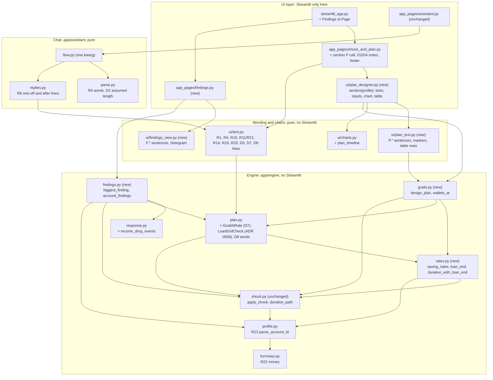
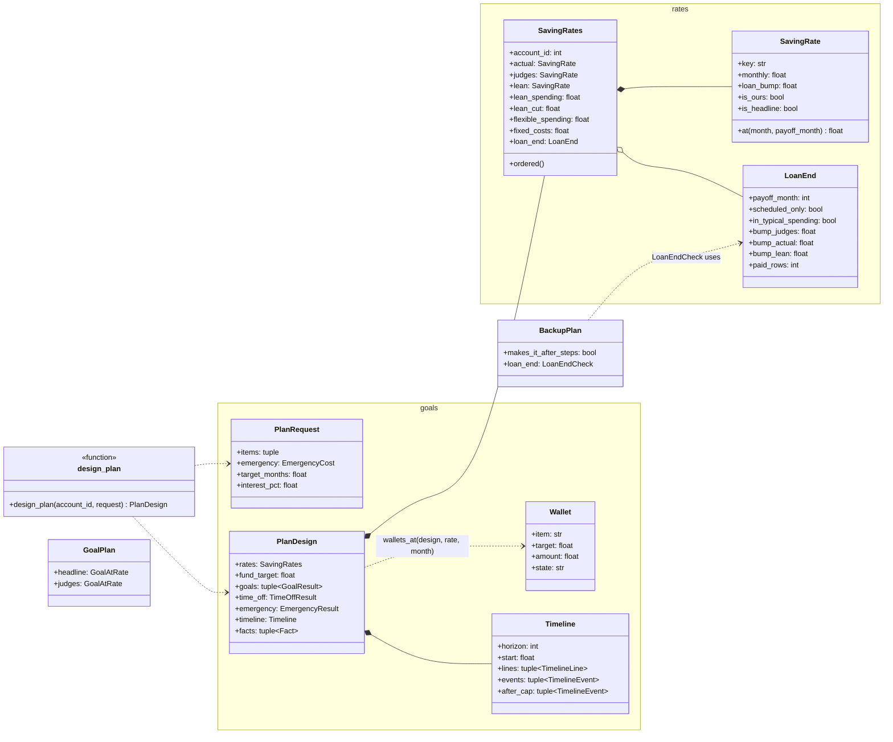
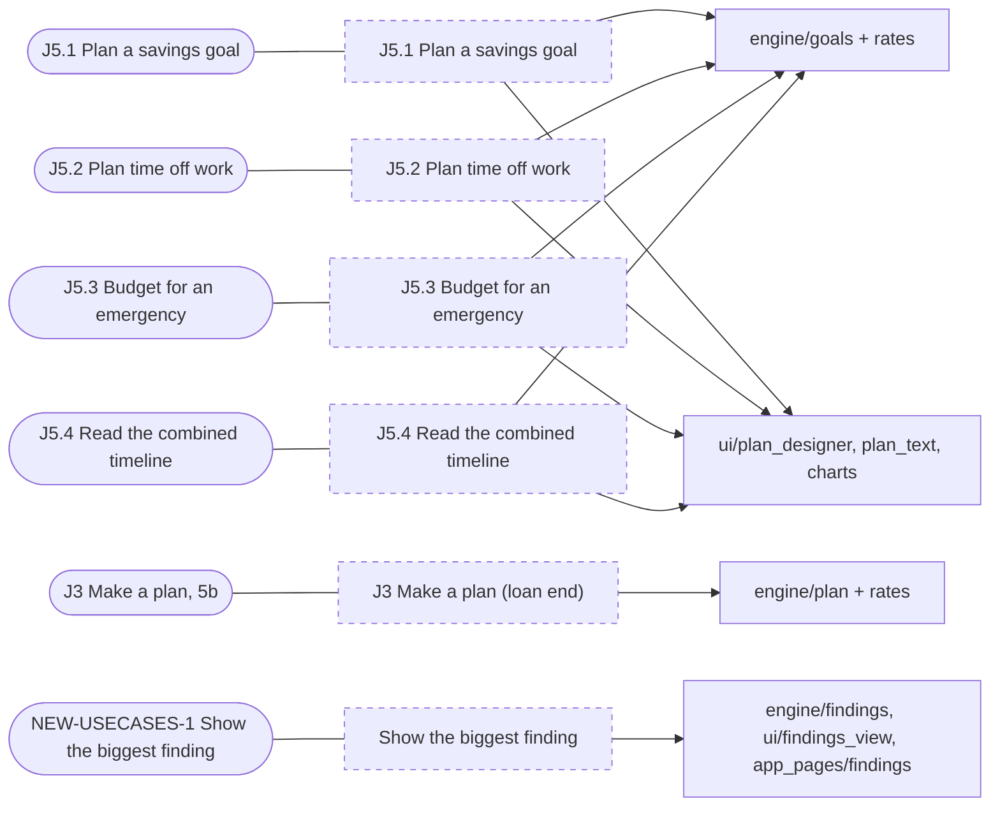
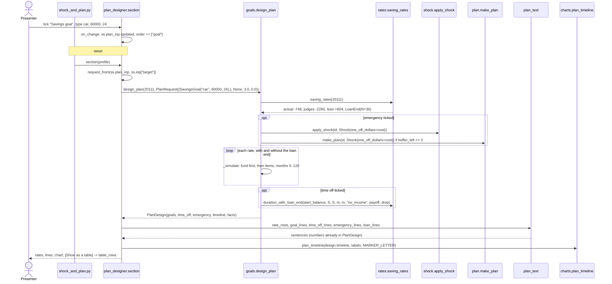
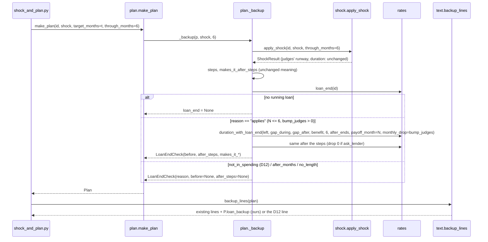
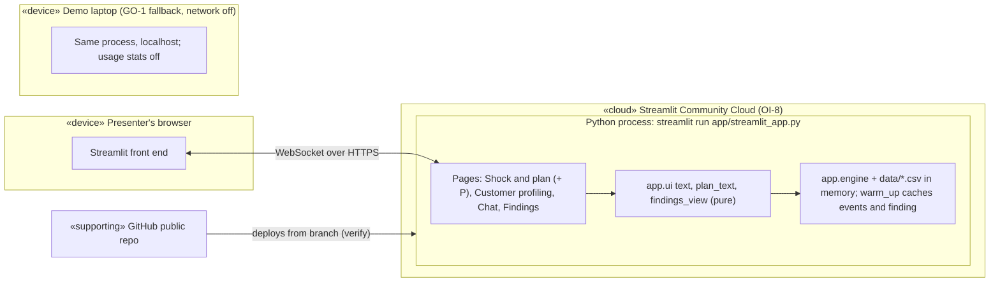

# Architecture: J5 Design a plan, the loan end, and the README review fixes

Status: proposed, 2026-11-07; revised 2026-11-08 (owner answers, brief Parts 6 to 8). Author: the architecture lead (elaboration). Decisions: [ADR 0006 to 0010](../adr/README.md). Build plan, test map and work packages: [`j5_plan_designer_build.md`](j5_plan_designer_build.md). Branch: `feature/guided-chat`.

Inputs: [brief Parts 1 to 8](../briefs/plan_designer_brief.md) (later parts win where they conflict: Part 8 over Part 7 over Part 6 over Part 5 and 5b over Parts 1 to 4), [J5 summary](../inception/use_cases.md#j5-design-a-plan), [J5.1 to J5.4](../inception/use_cases_plan.md), [BR-19 to BR-23, RU-23 to RU-31](../inception/requirements.md), [AC-11 to AC-20, OI-14 to OI-21](../inception/scope.md), [wireframes P](../design/ux/wireframes.md#p-plan-designer-j5), [copy §7, §11](../design/ux/copy.md#11-plan-designer-p), [engine contract](../engine_contract.md), [J4 design](j4_chat.md), ADR 0001 to 0005.

Every figure quoted here was rerun on the engine on 2026-11-07 (20111: lean rate $604, lean cut $2,864, flexible $6,269; 32078: buffer left −$12,513, lean budget $1,346; payoff months of the 448 running loans are 1 to 60, with 60, 125, 235 and 335 within 6, 12, 24 and 36 months). The brief Part 7 figures for 95548, 60630, 66505 and 20111 and the Findings counts were rerun on 2026-11-08 with `.venv/bin/python` against the current engine, and all match.

## Changes from v1 (2026-11-07)

| § | Change | Source |
| :-- | :-- | :-- |
| 2 | `findings.py` gains `account_findings` and depends on `profile` and `plan`; rule E5 added; `goals.py` gains `wallets_at` | NEW-SCOPE-5, NEW-SCOPE-7, WL-3 |
| 3.1 | `LoanEnd`: `bump_actual` and `bump_lean` no longer 0 on the 197; `bump_lean` is the capped formula; new field `paid_rows` | LE-1 to LE-5, ADR 0006 rev., ADR 0007 rev. |
| 3.2 | `MAX_INTEREST_PCT` settled (25, owner-modifiable, default rate 0). `DeadlineAnswer` gains `payoff_month`, `cut_with_loan`, `on_pace_with_loan`; `counts_loan_end` changes meaning. `EmergencyResult` gains `from_wallet`, `from_fund`. New `Wallet` and `wallets_at` | NEW-SCOPE-3, WL-3, WL-8, WL-9, ADR 0008 rev. |
| 3.4 | `BiggestFinding` gains `tiers`; new `FindingTier`, `AccountFindings`, `account_findings` | NEW-SCOPE-5, NEW-SCOPE-7, ADR 0009 rev. |
| 3.5, 3.6 | New exports; `plan_text.wallet_rows`, `table_rows` wallet columns, `findings_view.account_lines`; `PLAN_DEFAULTS` interest from the constant | as above |
| 4.2 | Per-rate rise rules LE-1 to LE-6; D12 for the judges' rate only; four worked accounts | LE-1 to LE-6 |
| 4.3 | Deadline: both cuts when N ≤ D; wallet split; emergency out of the wallet in progress first | WL-1 to WL-9 |
| 4.5, 6.3, 7 | Findings F1 to F6; F3 to F6 live and cached at first open; the rescued count shown in the app | NEW-SCOPE-5, NEW-SCOPE-7, D13 |
| 5 | NEW-COPY-22 reworded (judges only); NEW-COPY-27 replaced; NEW-COPY-30 to 32 added | LE-5, WL-8, WL-3, ADR 0009 |
| 9 | NEW-SCOPE-1 to 7 closed with the owner's answers; NEW-WF-3 added | Parts 6 and 8 |

## 1. What kind of system this is

- **System type: decision support** over a read-only, in-memory dataset. Same as J1 to J4. The plan designer adds no data and no transactions. It projects the balance forward under fixed, stated rules, and every figure comes from the engine (brief fixed rules, AC-19).
- **Reference architecture: a what-if planning model**, as in personal-finance planners: inputs → scenario model → projection → presentation. As a checklist it showed the parts we need. The **scenario** is a `PlanRequest`, the **model** is `engine/rates.py` (the rates and the loan end), the **projection** is `engine/goals.py` (a month-by-month simulation), and the **presentation** is `ui/plan_text.py`, `ui/charts.py` and the page section. The other candidate was a spreadsheet-style closed-form calculator (months = need ÷ rate). It can't handle a rate that changes at the payoff month, ordered goals, time off in the middle, interest, or the 120-month cap, so it fails RU-24 to RU-27.
- **Pattern: the existing layered, functional-core split, extended.** The pattern is pure engine functions behind a thin Streamlit shell, as in [ADR 0003](../adr/0003-pure-chat-state-machine-and-thin-page.md). It beats putting the projection in the page, for three reasons:
  - the 4,500-account sweeps (AC-16) must run without Streamlit;
  - the chat has to be able to call the same function later (brief Part 1, "Chat");
  - the brief forbids numbers in the UI.

  No new pattern is introduced. A plugin or strategy layer for the three rates was considered and rejected as over-engineering: there are exactly three rates, and they are fixed by the owner.

| Quality attribute | How the design serves it |
| :-- | :-- |
| Correctness (judges' numbers) | No change to `formulas.runway_from`, `apply_shock` or `get_profile`. Every new figure is a separate field. `test_judges_parity.py` is an independent oracle over 4,500 accounts × 13 shocks (R18) |
| Explainability | Each rate is labelled, the headline comes first (D7), and every one of our figures ends "(ours)". The month-by-month table holds the same values as the chart (BR-22) |
| Modifiability | `design_plan` takes one `PlanRequest`. Adding a plan kind means adding an `Item` type, not changing the page contract |
| Performance | One plan is 3 rates × 2 runs (with and without the loan end) × at most 121 steps, which is microseconds of Python. The Findings head (F1, F2) reuses the income-drop pass that `warm_up()` already makes, so startup doesn't grow. F3 to F6 need every profile plus 4,500 `make_plan` runs, about a minute cold (50 s profiles + 4.5 s plans, measured 2026-11-08), so they are computed at the first Findings open and cached (ADR 0009) |
| Testability | Pure functions and frozen dataclasses. No Streamlit in `engine/`, `ui/plan_text.py` or `ui/findings_view.py` (import-guard test) |

## 2. Design model: Software System Architecture



**Dependency rules** (the existing D1 to D6 of [J4 §2](j4_chat.md#2-design-model-software-system-architecture), plus E1 to E4, checked by AST in `test_chat_imports.py`):

- **E1.** `engine/rates.py` imports only `data`, `errors`, `formulas`, `profile` and `shock`. It must not import `plan` or `goals`, which removes the cycle risk: `plan` imports `rates`.
- **E2.** `engine/goals.py` may import `rates`, `plan`, `shock`, `profile`, `formulas` and `errors`. Nothing in the engine imports `goals`, except `__init__`.
- **E3.** `ui/plan_text.py` and `ui/findings_view.py` import no Streamlit. `findings_view` may import `altair`.
- **E4.** `app/assistant/` may import `app.engine.goals` later (stretch). No such import exists in this increment.
- **E5** (2026-11-08). `engine/findings.py` imports only `data`, `response`, `profile`, `shock` (for `get_preset`) and `plan`. Nothing in the engine imports `findings`, except `__init__`.

### Subsystems

| Subsystem | Concern | Public interface | Main internals |
| :-- | :-- | :-- | :-- |
| `engine/rates.py` (new) | The three monthly saving rates, and a running loan's scheduled end | `RATE_KEYS`, `LEAN_QUANTILE`, `LoanEnd`, `SavingRate`, `SavingRates`, `lean_above_fixed`, `loan_end`, `saving_rates`, `duration_with_loan_end` | `_payoff_month`, `_bumps`, the piecewise-linear path |
| `engine/goals.py` (new) | The plan designer projection: the fund first, then the items in tick order, plus an emergency at month 0, over at most 120 months | `MAX_INTEREST_PCT`, `SavingsGoal`, `TimeOff`, `EmergencyCost`, `PlanRequest`, `Reach`, `DeadlineAnswer`, `GoalResult`, `TimeOffCheck`, `TimeOffResult`, `Rebuild`, `EmergencyResult`, `TimelineEvent`, `TimelineLine`, `Timeline`, `PlanDesign`, `Wallet`, `design_plan`, `wallets_at` | `_check_request`, `_simulate(rate, with_loan)`, `_deadline`, `_cut_with_loan`, `_time_off_check`, `_emergency`, `_horizon` |
| `engine/plan.py` (changed) | Goal and backup plans (J3) | adds `GoalAtRate`, `LoanEndCheck`, `GoalPlan.headline`, `GoalPlan.judges`, `BackupPlan.loan_end`; `LEAN_QUANTILE` is re-exported from `rates` | `_goal_at`, `_loan_end_check`; `_lean_above_fixed` moves to `rates.lean_above_fixed` |
| `engine/response.py` (changed) | The real income-drop events and the spending response | adds `IncomeDropEvent` and `income_drop_events()`. `find_events` and `spending_response` keep their outputs exactly | one pass, cached |
| `engine/findings.py` (new) | The Findings page's figures (D10, D13 and the notebook findings F1 to F6) | `FindingTier`, `BiggestFinding`, `biggest_finding()`, `AccountFindings`, `account_findings()` | medians and counts over `income_drop_events()`; one sweep of `get_profile`, `account_flows` and `make_plan`, cached at first use |
| `ui/plan_text.py` (new) | Every P.* sentence, the marker labels and the table rows | see §3.6 | class `P` (the copy strings) |
| `ui/findings_view.py` (new) | F.* sentences and the histogram | `F`, `numbers`, `lines`, `tier_rows`, `account_lines`, `chart`, `alt_text` | |
| `ui/plan_designer.py` (new) | Region P on Shock and plan | `section(profile)`, `request_from(values)`, `PLAN_DEFAULTS` | `ss.plan_inp` sync, as `inputs()`/`sync_widgets()` already do on the page |



## 3. Frozen interfaces

The software-engineer lead commits these **verbatim** in task T0 (build §3), with stub bodies that return the simplest valid value. After T0 they are frozen. T0 hadn't been committed on 2026-11-08 (there is no `app/engine/rates.py`), so the 2026-11-08 changes are made here before the freeze, and each is marked `# CHANGED 2026-11-08` or `# NEW 2026-11-08` in the listings. A change needs the lead's agreement and a message to every package (the J4 rule). Docstring comments state the meaning; the build may add private helpers.

### 3.1 `app/engine/rates.py` (new)

```python
"""Our monthly saving rates and a running loan's scheduled end. Beside the judges' numbers, never in place of them (ADR 0006, ADR 0007)."""
from dataclasses import dataclass

LEAN_QUANTILE = 0.25                        # moved here from plan.py; plan.py re-exports it
RATE_KEYS = ("actual", "judges", "lean")    # display order; "actual" is the headline (D7, RU-23)


@dataclass(frozen=True)
class LoanEnd:
    status: str                 # "C" or "D" (running)
    payment: float              # P
    payoff_month: int           # N = (loan_start year*12 + month + duration_months) - (last data year*12 + month); 1..60 here
    scheduled_only: bool        # status D: N is the schedule, not a certainty (P.loan_d)
    in_typical_spending: bool   # profile.loan_median > 0. False on the 197 recent loans (D12). Sets the D12 line and bump_judges only  # CHANGED 2026-11-08
    bump_judges: float          # LE-2: min(P, loan_median); exactly 0.0 on the 197                                                # CHANGED 2026-11-08
    bump_actual: float          # LE-1: min(P, mean loan_payments over the last actual_months rows); > 0 on all 448, the 197 included  # CHANGED 2026-11-08
    bump_lean: float            # LE-3: min(S, Fx + P + L) - min(S, Fx + L), Fx = current_fixed_costs - P, L = SavingRates.lean_above; 0..P  # CHANGED 2026-11-08
    paid_rows: int              # k: rows of the last actual_months with loan_payments > 0 (ADR 0007 known limit; 156 of the 197 have k < 12)  # NEW 2026-11-08


@dataclass(frozen=True)
class SavingRate:
    key: str                    # one of RATE_KEYS
    monthly: float              # signed $ a month, before the payoff month
    loan_bump: float            # LoanEnd.bump_<key>, added from the payoff month on; 0.0 with no running loan  # CHANGED 2026-11-08 (comment)
    is_ours: bool               # actual and lean True; judges False
    is_headline: bool           # actual only

    def at(self, month: int, payoff_month: int | None) -> float:
        """Saving in month `month` (1-based): monthly, plus loan_bump once month >= payoff_month."""


@dataclass(frozen=True)
class SavingRates:
    account_id: int
    actual: SavingRate          # account_flows(id).change_last_12, equal to GoalPlan.actual_change_last_12
    judges: SavingRate          # I - S
    lean: SavingRate            # I - lean_spending (OI-14 default)
    lean_spending: float        # S - lean_cut
    lean_cut: float             # max(flexible_spending - lean_above, 0): equals the backup's orders + lean_months saving (2,864 on 20111)
    lean_above: float           # max(lean_above_fixed(id) - max(bills_on_standing_orders - H, 0), 0)
    flexible_spending: float    # max(S - current_fixed_costs, 0)
    fixed_costs: float          # current_fixed_costs
    loan_end: LoanEnd | None    # None without a running loan
    actual_months: int          # rows behind the actual rate: min(12, n_months)

    @property
    def ordered(self) -> tuple[SavingRate, SavingRate, SavingRate]:
        """(actual, judges, lean): the headline first."""


def lean_above_fixed(account_id: int) -> float:
    """Spending above bills, insurance and loan payments in the lowest LEAN_QUANTILE of months. Cached. Same value as the old plan._lean_above_fixed."""


def loan_end(account_id) -> LoanEnd | None: ...


def saving_rates(account_id) -> SavingRates:
    """parse_account_id first, then cached per id."""


def duration_with_loan_end(buffer_left: float, gap_during: float, gap_after: float, benefit_months: int | None, months_asked: int,
                           after_ends: str, *, payoff_month: int | None, monthly_drop: float):
    """shock.duration_path with the gap smaller by monthly_drop from month payoff_month on. Returns shock.DurationResult.
    Returns duration_path(...) itself (same object fields, bit for bit) when payoff_month is None, monthly_drop <= 0
    or payoff_month > months_asked."""
```

**Path rule.** `balance(t) = base(t) + monthly_drop × max(0, t − payoff_month + 1)`, where `base` is `duration_path`'s balance. The path is linear inside each month, so the first month `t` with `balance(t) < 0` gives:

- `runs_out_in_month = t`;
- `lasts = (t − 1) + balance(t − 1) / (balance(t − 1) − balance(t))`;
- `months_short = round(months_asked − lasts, 1)`;
- `money_lasts_months` from the same scan out to `MAX_MONTHS`, or `None`.

`makes_it = buffer_left > 0 and min(path) >= 0`, as in `duration_path`.

### 3.2 `app/engine/goals.py` (new)

```python
"""The plan designer: savings goals, time off and an emergency cost on one month-by-month timeline. Ours throughout (ADR 0008)."""
from dataclasses import dataclass

MAX_ITEMS = 4                     # ours; the page sends at most one goal and one time off (MVP)
MAX_INTEREST_PCT = 25.0           # owner-set upper bound for {interest_pct}, % a year; change it here only (the page reads it). NEW-SCOPE-3  # CHANGED 2026-11-08
MARKER_CODES = ("fund_reached", "goal_reached", "goal_bought", "time_off_start", "time_off_end", "emergency_cost", "loan_paid_off")


@dataclass(frozen=True)
class SavingsGoal:
    name: str                     # {goal_name}: stripped, 1..40 characters; the page sends "goal" when blank
    amount: float                 # {amount} >= 0
    deadline_months: int | None = None    # {deadline_months}: whole 1..120


@dataclass(frozen=True)
class TimeOff:
    months_off: int               # {months_off}: whole 1..120 (RU-29)


@dataclass(frozen=True)
class EmergencyCost:
    cost: float                   # {cost} >= 0 (RU-30)


Item = SavingsGoal | TimeOff


@dataclass(frozen=True)
class PlanRequest:
    items: tuple[Item, ...] = ()            # in tick order (RU-24); 0..MAX_ITEMS
    emergency: EmergencyCost | None = None  # always at month 0 (OI-18)
    target_months: float = 3.0              # J3's fund target (OI-5); same validation as make_plan
    interest_pct: float = 0.0               # % a year, 0..MAX_INTEREST_PCT, default 0 (owner); monthly at /12 on a positive balance only (OI-19, RU-25)


@dataclass(frozen=True)
class Reach:
    """When one item is reached on one rate."""
    rate: str                     # one of RATE_KEYS
    state: str                    # "now" (month 0) | "reached" | "over_cap" | "never", counting the loan end
    month: int | None             # month reached, 0..120; None unless now or reached
    state_no_loan: str            # the same, without the loan end
    month_no_loan: int | None
    cut_to_start: float | None    # -rate.monthly when rate.monthly <= 0 (P.g_cut_start), else None
    cut_to_reach_by_cap: float | None   # -rate.monthly + need / 120 when rate.monthly <= 0, else None (no loan end, no interest)


@dataclass(frozen=True)
class DeadlineAnswer:
    months: int
    need: float                   # max(fund_value + earlier items + amount - (B - cost), 0)
    monthly_needed: float         # need / months when interest is 0; else the smallest level saving that reaches need, to the cent
    headline_rate: float          # rates.actual.monthly
    cut_needed: float             # the cautious cut, without the loan end: max(monthly_needed - headline_rate, 0); shown first
    on_pace: bool                 # cut_needed == 0 (P.g_on_pace)
    flexible_spending: float
    cut_share_of_flexible: float | None   # cut_needed / flexible, None when flexible is 0
    lean_cut: float
    within_lean: bool             # cut_needed <= lean_cut
    over_flexible: bool           # cut_needed > flexible_spending (P.g_cut_over)
    includes_fund: bool           # the fund is still to finish (P.g_fund_first)
    counts_loan_end: bool         # a running loan with payoff_month <= months and rates.actual.loan_bump > 0: the second cut is shown (WL-8)  # CHANGED 2026-11-08
    payoff_month: int | None      # N when counts_loan_end, else None                                                                          # NEW 2026-11-08
    cut_with_loan: float | None   # counting the loan end: max((need - sum(actual.at(t, N) for t in 1..months)) / months, 0);
                                  # with interest, the smallest level cut reaching need by `months` on the with-loan run, to the cent.
                                  # None unless counts_loan_end                                                                                 # NEW 2026-11-08
    on_pace_with_loan: bool | None    # cut_with_loan == 0; None unless counts_loan_end                                                        # NEW 2026-11-08


@dataclass(frozen=True)
class GoalResult:
    goal: SavingsGoal
    position: int                 # 1-based in request.items
    fund_needed: float            # max(fund_value - (B - cost), 0) when position is 1, else 0.0 (P.g_needed)
    total_needed: float           # fund_needed + amount
    state: str                    # "zero" (amount 0, P.g_zero) | "now" (every rate at month 0, P.g_now) | "planned"
    reach: tuple[Reach, Reach, Reach]     # actual, judges, lean
    deadline: DeadlineAnswer | None


@dataclass(frozen=True)
class TimeOffCheck:
    rate: str
    started_now: bool             # not saved by month 120, so checked from month 0 on B (P.o_now, OI-17)
    start_month: int
    start_balance: float
    duration: object              # shock.DurationResult from duration_with_loan_end(start_balance, S, S, m, m, "no_income", ...)
    counts_loan_end: bool         # the payoff falls inside the time off and bump_judges > 0


@dataclass(frozen=True)
class TimeOffResult:
    time_off: TimeOff
    position: int
    amount: float                 # months_off * S (P.o_amount)
    lean_amount: float            # months_off * lean_spending (ours)
    reach: tuple[Reach, Reach, Reach]     # saved when the balance >= fund + amount
    checks: tuple[TimeOffCheck, TimeOffCheck, TimeOffCheck]


@dataclass(frozen=True)
class Rebuild:
    rate: str
    to_buffer: Reach              # back to max(B, 0)
    to_fund: Reach | None         # None when there is no fund target


@dataclass(frozen=True)
class EmergencyResult:
    cost: float
    buffer_before: float          # B
    buffer_left: float            # apply_shock(id, Shock(one_off_dollars=cost)).buffer_left (AC-14)
    covered: bool                 # buffer_left > 0
    backup: object | None         # plan.BackupPlan from make_plan(id, Shock(one_off_dollars=cost)) when not covered
    lean_budget: float            # rates.lean_spending
    lean_fixed: float             # min(rates.fixed_costs, lean_budget)
    lean_other: float             # lean_budget - lean_fixed
    rebuild: tuple[Rebuild, Rebuild, Rebuild]
    from_wallet: float            # min(cost, max(B - fund_value, 0)): out of the wallet in progress first (WL-9)  # NEW 2026-11-08
    from_fund: float              # cost - from_wallet: then out of the fund wallet, which may go negative       # NEW 2026-11-08


@dataclass(frozen=True)
class TimelineEvent:
    month: int | None             # None only in Timeline.after_cap
    code: str                     # one of MARKER_CODES
    rate: str | None              # None for emergency_cost and loan_paid_off (the same on every line)
    item: str | None              # the goal name for goal_*; None otherwise


@dataclass(frozen=True)
class TimelineLine:
    rate: str
    balance: tuple[float, ...]    # months 0..horizon; [0] = B - cost (after the month-0 emergency)


@dataclass(frozen=True)
class Timeline:
    horizon: int                  # 12..120 (RU-26)
    start: float                  # B, the point before month 0's emergency cost (AC-15)
    lines: tuple[TimelineLine, TimelineLine, TimelineLine]   # actual, judges, lean
    events: tuple[TimelineEvent, ...]       # month <= horizon, sorted by (month, RATE_KEYS order, MARKER_CODES order)
    after_cap: tuple[TimelineEvent, ...]    # items not reached by month 120 (J5.4 2b)


@dataclass(frozen=True)
class PlanDesign:
    account_id: int
    request: PlanRequest
    rates: object                 # rates.SavingRates
    fund_target: float | None     # target_months * S; None when S <= 0 (P.no_fund)
    goals: tuple[GoalResult, ...]
    time_off: TimeOffResult | None
    emergency: EmergencyResult | None
    timeline: Timeline
    facts: tuple                  # shock.Fact codes: no_fund_target, no_buffer, data_stops_early, loan_scheduled_only,
                                  # loan_not_in_spending, interest_applied, pension_time_off, rates_disagree


def design_plan(account_id, request: PlanRequest | None = None) -> PlanDesign:
    """No shock is used (RU-11). Raises InvalidPlanError(field) with field in
    items, name, amount, deadline_months, months_off, cost, interest_pct, target_months."""


@dataclass(frozen=True)
class Wallet:                                                                                    # NEW 2026-11-08
    """One wallet on one line at one month: a split of that line's balance, presentation only (ADR 0008 decision 7)."""
    item: str                     # "fund", the goal name, or "time_off"
    position: int                 # 0 for the fund, else 1-based in request.items
    target: float                 # fund_value; the goal amount; months_off * S
    amount: float                 # fund: min(balance, fund_value), may be negative; in progress: max(balance - fund_value, 0); else 0.0
    state: str                    # "filling" | "full" (fund only) | "waiting" | "spending" (time off running) | "accomplished"
    month_accomplished: int | None    # the line's reached month (goal: bought the same month; time off: its end); None if not by 120


def wallets_at(design: PlanDesign, rate: str, month: int) -> tuple[Wallet, ...]:              # NEW 2026-11-08
    """The wallets of design.timeline's `rate` line at `month` (0..horizon), the fund first (omitted when fund_target
    is None), then the items in tick order. Exactly one wallet is "filling" or "spending" unless all are accomplished.
    With a fund target, sum(w.amount) == the line's balance[month]. Raises InvalidPlanError("month") outside 0..horizon."""
```

(`object` stands in for engine types imported at runtime to keep this listing short. T0 writes the real annotations: `DurationResult`, `BackupPlan`, `SavingRates`, `tuple[Fact, ...]`.)

### 3.3 `app/engine/plan.py` additions

```python
@dataclass(frozen=True)
class GoalAtRate:
    rate: str                         # "actual" (headline, ours) or "judges" (I - S)
    monthly: float                    # the rate, signed
    state: str                        # the GoalPlan.state codes
    monthly_amount: float             # monthly * surplus_share when monthly > 0, else 0
    months_to_goal: int | None
    reaches_within_horizon: bool
    cut_to_break_even: float | None
    cut_to_reach_in_horizon: float | None
    cut_is_possible: bool | None


@dataclass(frozen=True)
class LoanEndCheck:
    """Ours (RU-28, ADR 0006). The backup plan's month-by-month check with the gap falling at the payoff month."""
    payoff_month: int
    monthly_drop: float               # LoanEnd.bump_judges: the part of P inside S and so inside the shocked gap
    scheduled_only: bool              # status D
    reason: str                       # applies | after_months | not_in_spending | no_length | no_shock
    before: object | None             # DurationResult for the shock alone, counting the loan end
    after_steps: object | None        # the same after the steps; drop 0 if an ask_lender step already pauses P
    makes_it_before: bool | None
    makes_it_after_steps: bool | None

# GoalPlan gains, appended last:  headline: GoalAtRate | None = None;  judges: GoalAtRate | None = None
# BackupPlan gains, appended last: loan_end: LoanEndCheck | None = None
```

- After WP-E1, `_goal` always sets `headline` (actual) and `judges` (a mirror of the existing flat fields, which keep the judges' meaning). The defaults exist only so the T0 scaffold runs.
- `_backup` sets `loan_end` whenever `p.running_loan`; otherwise it stays `None`.
- `reason` is decided in this order:
  1. `no_shock`;
  2. `no_length` (`through_months` is `None`);
  3. `not_in_spending` (`in_typical_spending` is False: D12);
  4. `after_months` (`payoff_month > through_months`);
  5. otherwise `applies`.

  `before` and `after_steps` are filled only for `applies`.
- **`makes_it_before`, `makes_it_after_steps`, `state` and `steps` keep their meaning bit for bit** (ADR 0006). So the D13 count, 1,526 by cuts plus 22 with `ask_lender`, doesn't move.

### 3.4 `app/engine/response.py` and `findings.py`

```python
# response.py
@dataclass(frozen=True)
class IncomeDropEvent:
    account_id: int
    start_month: str
    start_buffer_months: float    # month-end balance before the drop / trailing median spending
    base_in: float                # trailing 12-month medians, excluding the month itself
    base_out: float
    in_mean: float                # first MIN_MONTHS months
    out_mean: float
    start_balance: float          # month-end balance before the drop
    end_balance: float            # month-end balance after MIN_MONTHS months
    income_kept: float            # in_mean / base_in
    spending_kept: float          # out_mean / base_out
    predicted_end: float          # start_balance - MIN_MONTHS * (base_out - in_mean): spending held flat
    pass_through: float           # (base_out - out_mean) / (base_in - in_mean)

def income_drop_events() -> tuple[IncomeDropEvent, ...]:
    """Cached. The one pass over the data; find_events and spending_response read it and return exactly what they did."""

# findings.py
@dataclass(frozen=True)
class FindingTier:                                                     # NEW 2026-11-08
    name: str                     # SpendingResponse tier names: "Under 2 months", "2 to 6 months", "6 or more months"
    events: int                   # 410, 219, 106
    spending_kept_median: float   # median spending_kept in the tier: 0.37, 0.71, 2.47 (discovery §5 tier table)
    pass_through: float           # ResponseTier.raw_pass_through: 0.70, 0.27, -1.21

@dataclass(frozen=True)
class BiggestFinding:
    events: int                   # 735
    accounts: int                 # 480
    income_kept_median: float     # 0.13
    spending_kept_median: float   # 0.50
    within_10pct_share: float     # 0.05: spending stayed within 10% of usual
    predicted_below_zero: int     # 493: predicted_end < 0
    actually_below_zero: int      # 31: end_balance < 0
    months: int                   # MIN_MONTHS (3)
    threshold: float              # DROP_THRESHOLD (0.55)
    spending_kept: tuple[float, ...]   # one per event, for the chart
    evidence: str                 # SpendingResponse.evidence (the limits line)
    tiers: tuple[FindingTier, FindingTier, FindingTier]   # by start_buffer_months, edges 2 and 6 (F2)   # NEW 2026-11-08

def biggest_finding() -> BiggestFinding: ...   # cached; reads only income_drop_events() and spending_response()

@dataclass(frozen=True)
class AccountFindings:                                                 # NEW 2026-11-08 (F3 to F6, ADR 0009)
    accounts: int                 # 4,500
    ei6_runs_out: int             # 1,596: job_loss_ei preset, through_months=6, backup.makes_it_before is False
    rescued_by_cuts: int          # 1,526: of those, makes_it_after_steps and no ask_lender step (D13)
    rescued_with_lender: int      # 22: makes_it_after_steps only with an ask_lender step
    rescued_total: int            # 1,548
    surplus_accounts: int         # 3,309: I - S > 0
    surplus_not_in_balance: int   # 1,038: of those, account_flows.change_last_12 <= 0
    running_loans: int            # 448
    loans_missed_by_medians: int  # 197: loan_median == 0 (D12)
    missed_payment_median: float  # 2,545.40: median P on those
    pension_accounts: int         # 740: income_type == "Pension"

def account_findings() -> AccountFindings: ...   # cached at first use (lru_cache); NOT called by warm_up()
```

`warm_up()` adds `biggest_finding()` after `spending_response()`. The cost is a few medians over 735 rows. `account_findings()` costs about a minute cold and runs at the first Findings open (ADR 0009 decision 3).

### 3.5 `app/engine/__init__.py` (T0)

The new exports are `AccountFindings` (2026-11-08), `BiggestFinding`, `DeadlineAnswer`, `EmergencyCost`, `EmergencyResult`, `GoalAtRate`, `GoalResult`, `IncomeDropEvent`, `LoanEnd`, `LoanEndCheck`, `PlanDesign`, `PlanRequest`, `Reach`, `Rebuild`, `SavingRate`, `SavingRates`, `SavingsGoal`, `TimeOff`, `TimeOffCheck`, `TimeOffResult`, `Timeline`, `TimelineEvent`, `TimelineLine`, `Wallet` (2026-11-08), `FindingTier` (2026-11-08), `account_findings` (2026-11-08), `biggest_finding`, `design_plan`, `income_drop_events`, `loan_end`, `saving_rates` and `wallets_at` (2026-11-08), plus `warm_up` as above.

### 3.6 Wording and UI signatures

```python
# app/ui/text.py (additions; existing signatures unchanged)
def months_word(n) -> str: ...            # "1 month" when n == 1, else f"{n:g} months" (NEW-COPY-9)
def runway_words(runway) -> str: ...      # "under 0.1 months" when state "months" and months == 0.0, else runway.label (R11, R21)
def in_sentence(label: str) -> str: ...   # "No shortfall (120+)" -> "no shortfall (120+)" mid-sentence (R4)
def oneoff_line(r) -> str | None: ...     # D4, R6: NEW-COPY-18; None when r.one_off == 0
def after_line(r) -> str: ...             # R6: NEW-COPY-19
ASSUMED_LENGTH: str                       # D2, R7: NEW-COPY-17
FOOTER: str                               # R2: NEW-COPY-24
# backup_lines(plan) appends the P.loan_backup or D12 line when plan.backup.loan_end.reason in ("applies", "not_in_spending")

# app/ui/plan_text.py (new)
class P: ...                              # every P.* string of copy §11 plus NEW-COPY-22, 26, 27, 28, 30  # CHANGED 2026-11-08
def rate_label(key: str) -> str: ...
def rate_rows(rates) -> list[tuple[str, str, bool]]: ...        # (label, "+$604 a month", is_headline), headline first
def goal_lines(design, goal) -> list[str]: ...
def time_off_lines(design) -> list[str]: ...
def emergency_lines(design) -> list[str]: ...
def loan_lines(design) -> list[str]: ...  # P.loan_d, D12 line
def fact_lines(design) -> list[str]: ...
MARKER_LETTER: dict[str, str]             # fund_reached F, goal_reached G, goal_bought B, time_off_* O, emergency_cost E, loan_paid_off L
def marker_label(event) -> str: ...       # P.m_* with {goal_name}
def timeline_alt(design) -> str: ...      # P.tl_alt
def after_cap_line(design) -> str | None: ...   # NEW-COPY-28
def wallet_rows(design, month: int = 0) -> list[tuple[str, str, str]]: ...   # NEW 2026-11-08: (wallet label, "$x of $y", state label) from wallets_at(design, "actual", month)
def table_rows(design) -> list[dict]: ... # {"Month": m, <three rate labels>: money, <one column per wallet, headline line>: money, "Events": "; ".join(labels)}  # CHANGED 2026-11-08

# app/ui/charts.py (addition)
def plan_timeline(timeline, rate_labels: dict[str, str], marker_letter: dict[str, str]): ...   # altair LayerChart

# app/ui/plan_designer.py (new, Streamlit)
PLAN_DEFAULTS = dict(goal_on=False, goal_name="car", amount=60000.0, deadline=0, interest=0.0,   # interest box: 0..goals.MAX_INTEREST_PCT  # CHANGED 2026-11-08
                     off_on=False, months_off=24, em_on=False, cost=10000.0, order=[], table=False)
def request_from(values: dict, target_months: float) -> PlanRequest: ...   # pure; deadline 0 means none
def section(profile) -> None: ...

# app/ui/findings_view.py (new, pure)
class F: ...
def numbers(f) -> list[tuple[str, str]]: ...   # three (label, value) pairs
def lines(f) -> list[str]: ...
def tier_rows(f) -> list[tuple[str, str, str]]: ...   # NEW 2026-11-08: (tier, events, "37%") for F2
def account_lines(a) -> list[str]: ...                # NEW 2026-11-08: F3 to F6 from AccountFindings (NEW-COPY-31)
def chart(f): ...                               # altair histogram of spending_kept, 10% bins, 200%+ last, rule at 100%
def alt_text(f) -> str: ...

# app/assistant/state.py: Source = Literal["button", "typed", "parsed", "assumed"]; ASSUMED_MONTHS = 6
# app/assistant/replies.py: result_lines(r, p, *, assumed_months: bool = False) -> tuple[str, ...]
# app/engine/profile.py: parse_account_id(value) also accepts "20,111" (thousands groups) and "20111.0" (trailing .0+)
```

## 4. Engine behaviour

### 4.1 Saving rates (ADR 0007)

| Rate | Formula | Label (copy §11) | Ours? |
| :-- | :-- | :-- | :-- |
| actual (headline) | `account_flows(id).change_last_12`: mean of money in − money out over the last 12 rows | `P.r_actual` | yes |
| judges | I − S | `P.r_judges` | no |
| lean | I − (S − lean_cut) | `P.r_lean` | yes |

For 20111 the three rates are −$748, −$2,260 and +$604 (AC-11). The short-history note is gated on OI-12; the actual rate uses `min(12, n_months)` rows, and the shortest history is 12.

### 4.2 Loan end (ADR 0006)

- **Payoff month N.** N is `loan_start` month + `duration_months` − the account's last data month. For 20111 that is 2023-12 + 60 − 2025-12 = 36. N is always at least 1 in this data, and the two stale accounts have N of 10 (48938) and 5 (76493).
- **Rise from month N** (OI-16 default; revised 2026-11-08 per brief Part 7 LE-1 to LE-4, adopted in Part 8). From month N, each rate rises by the part of P it already contains (RU-27):
  - actual (LE-1): min(P, the mean of `loan_payments` over the last `actual_months` rows), **on every running loan, the 197 included**;
  - judges (LE-2): min(P, `loan_median`), exactly 0 on the 197;
  - lean (LE-3): `min(S, Fx + P + L) − min(S, Fx + L)`, with Fx = `current_fixed_costs` − P and L = `lean_above`; P unless S caps the lean spending;
  - no running loan (LE-4): 0 on every rate.
- **D12, narrowed (LE-5).** On the 197 accounts where `loan_median` is 0 (the `recent_loan_missed` note), only the judges' rise is 0, and the reworded D12 line (NEW-COPY-22) says so for the judges' figure. The actual and lean rates rise. On the 197: `bump_actual > 0` on all; `bump_lean` is the full P on 166, part of P on 29 and 0 on 2 (38528, 52185, where S is below fixed costs).
- **Worked accounts** (rerun 2026-11-08; the brief Part 7 table):

  | Account | P, N | actual → from N | judges → from N | lean rise |
  | :-- | :-- | :-- | :-- | :-- |
  | 95548 (C, one of the 197, 6 of 12 rows paid) | $2,956.31, 42 | $447.37 → $1,925.53 | −$101.63 → −$101.63 (+$0) | +$2,956.31 |
  | 60630 (C, one of the 197, 2 of 12 paid, S caps lean) | $2,201.82, 11 | $1,324.87 → $1,691.84 | +$0 | +$597.81 |
  | 66505 (C, 12 of 12 paid) | $1,982.83, 17 | $815.23 → $2,798.06 | −$950.62 → $1,032.22 | +$1,982.83 |
  | 20111 (D, 10 of 12 paid) | $2,330.19, 36 | −$747.89 → $1,193.83 | −$2,260.22 → $69.84 | +$2,330.19 |

- **Check on 20111** (status D, unchanged by the revision because its `loan_median` > 0), $60,000 car: lean takes 113 months, or 52 counting the loan; actual is never, or 115 counting the loan (bump $1,942, the 12-month mean, which matches wireframe P2); judges is never, and more than 120 months even counting the loan.
- **Backup plan (LE-6).** The check uses `bump_judges`, because the shocked gap is built from S. It stays `not_in_spending` on the 197, so the D13 count (1,526 + 22) is unchanged.

### 4.3 `design_plan` projection (ADR 0008)

```
fund_value = target_months * S if S > 0 else 0.0;   i = interest_pct / 1200
for each rate in (actual, judges, lean), for with_loan in (True, False):
    bal = B - cost                                # emergency at month 0 (OI-18); Timeline.start = B
    queue = [fund] + items                        # the fund is implicit and first (RU-24); skipped when fund_value == 0
    settle(month 0)
    for t in 1..120:
        interest = bal * i if bal > 0 else 0
        if a time off is running: flow = -(S - (bump_judges if with_loan and t >= N else 0))
        else:                     flow = rate.at(t, N if with_loan else None)
        bal += interest + flow
        if the time off ends at t: event time_off_end
        settle(t)
settle(t): while queue and its head is met at bal:
    fund:     bal >= fund_value                     -> fund_reached
    goal:     bal >= fund_value + amount            -> goal_reached and goal_bought at t; bal -= amount
    time off: bal >= fund_value + months_off * S    -> time_off_start at t; runs t+1 .. t+months_off; the head waits until it ends
```

- The **timeline lines** are the `with_loan=True` runs. `Reach.month_no_loan` comes from the `False` runs. A blocked item blocks every later one (sequential, RU-24).
- **`never`** means not reached, and the line's balance at month 120 is at or below its balance when the item became the head. Any other miss is `over_cap`. So interest that grows a positive balance gives `over_cap`, not `never`.
- **Horizon** is the larger of 12, every event month ≤ 120 on any line (including `loan_paid_off`) and every deadline, capped at 120. It is 120 whenever `after_cap` is non-empty.
- **Time-off check** (RU-29, OI-17, OI-20).
  - Start month: the line's `time_off_start` month, with the balance at that month.
  - If the time off isn't saved by month 120: month 0 on B (`started_now`).
  - The check is `duration_with_loan_end(start_balance, S, S, m, m, "no_income", payoff_month=max(N − start, 1), monthly_drop=bump_judges)`.
  - With no loan inside the time off, this equals `apply_shock(id, Shock(IncomeCut(0, m)), through_months=m).duration` when started now (AC-13).
  - The check doesn't apply interest. It is the engine's shock, unchanged.
- **Emergency** (RU-30): `buffer_left` and `backup` come from `apply_shock` and `make_plan` with `Shock(one_off_dollars=cost)`. Rebuild is a `Reach` on each line to `max(B, 0)` and to `fund_value`, starting at month 0.
- **Deadline** (revised 2026-11-08, ADR 0008 decision 5, WL-7, WL-8): `need = max(fund_value + earlier amounts + amount − (B − cost), 0)` and `monthly_needed = need ÷ D` at 0% interest, both unchanged and independent of the loan.
  - The **cautious cut** `cut_needed = max(monthly_needed − actual.monthly, 0)` is always shown, first.
  - When a running loan has N ≤ D and `actual.loan_bump > 0`, the **cut counting the loan end** `cut_with_loan = max((need − Σ_{t=1..D} actual.at(t, N)) ÷ D, 0)` is shown beside it. With interest, `_cut_with_loan` finds the smallest level cut that reaches `need` by D on the with-loan run, by bisection to the cent.
  - When N > D, or there's no running loan, `counts_loan_end` is False and only the cautious cut is shown.
  - AC-12 (20111, deadline 24, N = 36 > 24): need 25,799 + 60,000 − 17,612 = $68,188, ÷ 24 = $2,841.12; cut $3,589.01, one figure; 57% of $6,269; more than the $2,864 lean cut.
  - 20111, deadline 48: $1,420.56 a month; cut $2,168.45, or $1,642.57 counting the loan.
  - 66505, $60,000 car, deadline 36 (N = 17): need $93,200, $2,588.89 a month; cut $1,773.66, or $672.08 counting the loan. The car is reached in month 115, or 45 counting the loan; the fund in month 41, or 24.
- **Wallets** (ADR 0008 decision 7, WL-1 to WL-4, WL-9). `wallets_at(design, rate, month)` splits `lines[rate].balance[month]`:
  - the fund wallet = min(balance, fund_value), which may be negative (20111's goes to −$8,564 at month 35 on the actual line);
  - the wallet in progress, the first item not yet accomplished on that line = max(balance − fund_value, 0), state `filling`, or `spending` while a time off runs;
  - later items: $0, `waiting`; items accomplished at or before `month`: $0, `accomplished`, with `month_accomplished`.
  - The fund is `full` when balance ≥ fund_value. A goal is accomplished and bought in the same month (WL-4), so its wallet reads $0 from that month.
  - Saving fills the fund, then the items in tick order. At month 0 the emergency cost comes out of the wallet in progress first, then the fund: `EmergencyResult.from_wallet` and `from_fund`.
  - The split adds no number of its own: with a fund target, the wallets add up to the balance, and every month is the projection's (WL-3).

### 4.4 Goal plan (D7, R8)

`_goal_at(p, monthly, ...)` is the existing `_goal` logic with the rate as a parameter. `GoalPlan.headline = _goal_at(actual)` and `GoalPlan.judges = _goal_at(I − S)`. The existing flat fields equal `judges` (a test asserts it on all 4,500 accounts). `text.goal_lines` leads with the headline (NEW-COPY-20), then the judges' line. The chat's `EngineOutput.goal_state` stays `GoalPlan.state`, the judges' state (ADR 0005 unchanged).

### 4.5 Findings (R3, D10, D13; ADR 0009)

Revised 2026-11-08: the page is built from the knowledge in `discovery.ipynb`, `know_the_customer.ipynb` and `make_a_plan.ipynb` (NEW-SCOPE-5), and every figure is computed live by the engine and cached (NEW-SCOPE-7). ADR 0009 decision 4 lists the findings F1 to F6, their notebook values and which notebook findings stay off the page.

- **Head, at once from the warm cache (F1).** Three `st.metric` numbers: 735 income drops; 50%, the median spending kept; 31 of the 493 the formula put below $0 after 3 months. Under them is one Altair histogram of `spending_kept` (10% bins, the last bin 200%+, a rule at 100% labelled "the formula assumes 100%").
- **By starting buffer (F2).** A three-row table from `biggest_finding().tiers`: under 2 months 410 events, 37% kept; 2 to 6 months 219, 71%; 6+ months 106, 247%.
- **Across all accounts (F3 to F6), at the first open.** `st.spinner` while `account_findings()` runs (about a minute cold, **verify** on Community Cloud), then one line each: the rescued count in D13's wording (1,526 by cuts, plus 22 more if the lender agrees, 1,548 of the 1,596 that don't last 6 months on EI at 55%); 1,038 of 3,309 surplus accounts didn't grow; 197 of 448 running loans missed by typical spending, a median $2,545 a month; 740 pension accounts, where a layoff doesn't fit.
- **Then the limits line** (`evidence`) and a pointer to the notebooks for the findings kept there.

Nothing is hard-coded: `test_findings.py` asserts the engine's values equal the notebooks' stored outputs. The owner opens Findings once before judging, so the judges see it cached.

## 5. Copy and parser fixes

The copy owner (the UX author) numbers and files these in `copy.md`. The build uses the drafted text until then, as J4 did. `{x}` values come from `text.money`.

| ID | Fix | Where | Drafted text |
| :-- | :-- | :-- | :-- |
| NEW-COPY-11 | R1, D1 | `text.verdict` `income_cut_runs_out` when `months_short == 0.0` | "With income at {pct}% for {n}, the money runs out in month {m}, less than 0.1 months short." (`{n}` = `months_word`) |
| NEW-COPY-12 | R4 | `text.verdict` `cost_or_bills_only` | Labels equal: "After this, the runway is unchanged at {R}." Otherwise: "After this, the buffer lasts {R}, {down or up} from {in_sentence(R0)}." Direction from months; `None` (no shortfall) counts as the largest |
| (NEW-COPY-9 rule) | R10 | `verdict` (lines 113, 117), `goal_lines` (251, target), `backup_lines` (282), `_capped_line`, `runway_delta`, `", more than 12."` → `", more than 12 months."` | `months_word(n)`; "about 1 month short" |
| NEW-COPY-13 | R11, R21 | Sentences that print a runway (`summary_line`, verdict `open_ended` and `cost_or_bills_only`, `goal_lines`) | `runway_words`: "under 0.1 months" when the label is `0.0 months`. The label and metric keep `0.0 months`; `0 months` stays for B ≤ 0 (N.neg_buf explains it) |
| NEW-COPY-14 | R11 | `verdict` `no_shortfall` when after income and spending are both 0 | "No money in or out in a typical month, so there is nothing for the buffer to cover." |
| NEW-COPY-15 | R11, R19 | `summary_line` | I = S = 0: "Customer {id} has almost no activity: typical money in and spending are both $0. The buffer is {B}." I = 0 and S > 0 (before the capped case): "Customer {id} has no regular money in and spends about {S} a month. The buffer is {B}, so it would last {runway_words(R)}." |
| NEW-COPY-16 | R14 | `assumption_line` when `after_ends == "income_returns"` | "After month {n} we assume income returns to its typical level." |
| NEW-COPY-17 | D2, R7 | `text.ASSUMED_LENGTH`; page caption when "Laid off + bills up 15%" is selected; chat after the confirm and result lines when a length was assumed | "The card gives no length, so this assumes 6 months, as on the first card." The chat `{plain}` part is "for 6 months (assumed)" (`T.plain_months_assumed`) |
| NEW-COPY-18 | D4, R6 | `text.oneoff_line`: page region C (replaces "Total one-off") and chat `result_lines` | Months only: "One-off cost: {x}, {n} of typical spending before the shock ({S} a month)." Dollars only: "One-off cost: {x}." Both: "One-off cost: {x}: {d} plus {n} of typical spending before the shock ({S} a month)." (`{n}` = `months_word`) |
| NEW-COPY-19 | R6 | `text.after_line`, chat `result_lines` after the change line | "After the shock: money in {I1} a month, spending {S1} a month." |
| NEW-COPY-20 | D7, R8 | `text.goal_lines` first line (`headline`) | `on_track`: "At the actual change over the last 12 months ({rate} a month, ours), {t} of spending ({amt}) takes {n} to save." `no_surplus`: "Over the last 12 months the balance changed by {rate} a month (ours), so at that pace the fund isn't reached. Saving starts with spending {cut} a month less." `already_there`: unchanged. Then the existing judges' sentence, prefixed "On the judges' typical month ({I − S} a month): " |
| NEW-COPY-21 | D8, R9 | `plan._steps` actions | `cancel_other_orders`: "Cancel the other standing orders, if these aren't rent or bills. That saves {x} a month." `all_flexible`: "Cut the remaining {x} a month of other spending, if it isn't rent or bills. This leaves only fixed costs." `K.g_flex` gains: " Some of it may be rent or bills without a label." |
| NEW-COPY-22 | D12 narrowed by LE-5 (reworded 2026-11-08) | `plan_text.loan_lines`, `text.backup_lines` | "The loan payment of {P} a month isn't in the judges' typical spending yet, because the loan started recently, so the judges' figure doesn't rise when it ends in month {N} (ours)." |
| NEW-COPY-23 | R20 | `verdict` `runway_zero` when `abs(buffer_left) < 0.5` and there's no `no_buffer_before_shock` | "The one-off cost of {x} uses up the whole buffer of {B}. Nothing is left to live on." |
| NEW-COPY-24 | R2 | `text.FOOTER` | "Data: PKDD'99 Discovery Challenge Financial dataset, from the CTU Relational Dataset Repository (https://relational.fel.cvut.cz/dataset/Financial). EI weekly maximum: Government of Canada (https://www.canada.ca/en/services/benefits/ei/ei-regular-benefit/benefit-amount.html). Method notes are in the docs folder." |
| NEW-COPY-25 | R3, D10 | `findings_view.F` | page "Findings"; head "Biggest finding: spending doesn't stay flat after a shock"; numbers "Real income drops" `{events}` · "Spending kept, median" `{pct}%` · "Below $0 after 3 months" "{actual} of {predicted} predicted"; line "The judges' formula holds spending flat. In {events} real drops in money in, customers kept a median of {pct}% of their usual spending, so {actual} were below $0 after {months} months where the formula said {predicted}."; chart title "Spending kept during a real income drop"; rule label "The formula assumes 100%"; alt "Histogram of spending kept in {events} income drops. The median is {pct}%." Then `evidence` |
| NEW-COPY-26 | J5.1 5a with the loan end | `plan_text` | `P.loan_over`: "never at this rate, and more than 120 months counting the loan ending in month {N} (ours)." |
| NEW-COPY-27 | ADR 0008 decision 5, WL-8 (replaced 2026-11-08) | `plan_text.goal_lines` after the cautious cut, when `deadline.counts_loan_end` | Cut: "Counting the loan ending in month {N}, spend {cut_with_loan} a month less (ours)." On pace: "Counting the loan ending in month {N}, the current pace is enough (ours)." Status D adds `P.loan_d`. The old "The deadline figures don't count the loan ending." is withdrawn |
| NEW-COPY-28 | J5.4 2b | `plan_text.after_cap_line` | "After month 120: {events}." |
| NEW-COPY-30 | WL-3, ADR 0008 decision 7 (2026-11-08) | `plan_text.wallet_rows`, `table_rows` column heads | Head "Wallets (ours)"; row "{item}: {amount} of {target}"; states "filling", "full", "waiting for {previous}", "spending during the time off", "accomplished in month {m}"; a negative fund: "Emergency fund: {amount} of {target}, below $0 before the loan ends"; emergency: "The {cost} cost comes out of {from_wallet} saved for {item}, then {from_fund} of the emergency fund." Column head "{item} wallet" |
| NEW-COPY-31 | ADR 0009 decision 4 (2026-11-08) | `findings_view.F`, `tier_rows`, `account_lines` | Tier table head "Spending kept, by starting buffer"; F3 "Of the {fail} accounts that don't last 6 months on EI at 55%, {cuts} make it with cuts to their own spending, plus {lender} more if the lender agrees to pause the loan: {total} in all."; F4 "{n} of the {m} accounts with more money in than spending on paper didn't grow their balance over the last 12 months."; F5 "{n} of {m} running loans don't show in typical spending yet, a median {P} a month."; F6 "{n} accounts live on a pension, where a layoff doesn't fit."; spinner "Working out the figures across all 4,500 accounts. This takes about a minute the first time."; pointer "More findings, with their limits, are in the discovery notebook." |
| NEW-COPY-29 | J5.3 2a | `plan_text.emergency_lines` when B ≤ 0 | "The balance was already {B}, so the cost isn't what empties the buffer." (CON-5) |
| (copy §10, settled) | NEW-COPY-3, NEW-COPY-10 not yet built | `chat_text` | `cant_open` "a job loss with no end month"; `size_button` "Change {size} ({shown})" |

D5 was edited directly: the capped `summary_line` row in copy §2 and AC-6 in scope.

**R22:** `formulas.money` returns "$0" for any value that rounds to $0 (−0.3 included).

**Parser (R5, D2).** These are placeholders for the [`chat_parser.md`](../design/ux/chat_parser.md) owner to number as PT rows.

- `_WORDS` adds thirteen to twenty, the tens thirty to ninety and "hundred", plus compounds "fifty five" and "fifty-five" (tens + one to nine).
- `_HALF_YEAR` (`half a year`, `half-year`, `half year`) → 6. It is taken before `_YEARS`.
- **D2 rule:** a job kind plus a bills or repair kind, with no length found, gives months 6 with source `"assumed"`, shown "6 months (assumed)". The status is `ok`, so the confirm is still mandatory (ADR 0010). "laid off" alone still asks for the length (PT-12 unchanged).

| ID | Input | Expected |
| :-- | :-- | :-- |
| NEW-PARSER-1 | laid off, EI 55% for half a year | `ok` `IC(0.55, 6)` |
| NEW-PARSER-2 | EI pays 55% for half a year | `ok` `IC(0.55, 6)` (today `IC(0.55, 12)`) |
| NEW-PARSER-3 | bills up fifteen percent | `ok` `bills_increase_pct=15` |
| NEW-PARSER-4 | laid off, EI fifty-five percent for twenty months | `ok` `IC(0.55, 20)` |
| NEW-PARSER-5 | laid off, EI 55% for a year and bills up twenty percent | `ok` `IC(0.55, 12)`, `bills_increase_pct=20` |
| PT-04 (changed) | They lose their job (EI at 55%) and their household bills go up 15% in the same month. | `ok`: `IC(0.55, 6)` with months source `assumed`, `bills_increase_pct=15`; the confirm shows "for 6 months (assumed)" |
| NEW-PARSER-6 | laid off and the furnace dies, EI 55% | `ok`: `IC(0.55, 6)` assumed; the repair is `partial`. It asks the repair size, and the length stays assumed |

The cheatsheet slots get `{months}` "… or 'half a year'" and number words "one to twenty, tens, fifty-five". One row is added: "lose their job (EI {keep_pct}%) and bills go up {bills_pct}% → length assumed 6 months".

## 6. Interaction model

Collaborations are named as the use cases they realise. The owners are work packages until people are named (OI-9).



| Collaboration | Owner | Structure | Sequence |
| :-- | :-- | :-- | :-- |
| J5.1 Plan a savings goal | WP-E2 (engine), WP-UI (page) | §2 class diagram, `GoalResult`, `Reach`, `DeadlineAnswer` | §6.1 |
| J5.2 Plan time off work | WP-E2 | `TimeOffResult`, `TimeOffCheck`, `duration_with_loan_end` | §6.1 (the time-off branch) |
| J5.3 Budget for an emergency | WP-E2 | `EmergencyResult`, `Rebuild`; reuses `apply_shock` and `make_plan` | §6.1 (the emergency branch) |
| J5.4 Read the combined timeline | WP-UI | `Timeline`, `plan_timeline`, `table_rows` | §6.1 |
| J3 Make a plan (loan end) | WP-E1 | `LoanEnd`, `LoanEndCheck` | §6.2 |
| Show the biggest finding | WP-F | `IncomeDropEvent`, `FindingTier`, `BiggestFinding`, `AccountFindings`, `findings_view` | §6.3 |

### 6.1 Tick → engine → timeline (J5.1 to J5.4; AC-11 to AC-16)



**Invariants:**

- There is no arithmetic in `plan_designer.py` or `plan_text.py` beyond formatting. AC-19 is checked by a test that feeds `plan_text` a hand-built `PlanDesign` with sentinel values and finds each one in the output.
- The design never reads `ss.inp` shock keys (RU-11).
- `Timeline.start == B`, and each `lines[k].balance[0] == B − cost`.
- The table rows equal the line values.

### 6.2 Loan payoff inside the backup plan's duration check (J3 5b, RU-28; ADR 0006)



**Invariants (AC-18):**

- `apply_shock`'s output and `make_plan`'s existing fields are equal to their values before the change, on all 4,500 accounts × 5 presets. This is pinned by Counter snapshots: `verdict_case` per preset, `backup.state` per preset, and the 1,526 / 22 rescued split.
- With `monthly_drop = 0`, `duration_with_loan_end` returns `duration_path`'s result exactly.

### 6.3 Findings view (R3, D10; ADR 0009)

```mermaid
sequenceDiagram
    participant App as streamlit_app.py
    participant W as engine.warm_up
    participant RS as response
    participant FD as findings.biggest_finding
    participant FP as app_pages/findings.py
    participant FV as findings_view
    participant AF as findings.account_findings
    App->>W: start_engine() (st.cache_resource, once per process)
    W->>RS: spending_response()
    RS->>RS: income_drop_events() (one pass, cached)
    W->>FD: biggest_finding() (cached; medians over 735 events)
    Note over FP: later, the presenter opens Findings
    FP->>FD: biggest_finding() (cache hit)
    FP->>FV: numbers(f), lines(f), tier_rows(f), chart(f), alt_text(f)
    FV-->>FP: 3 metrics, 1 sentence, tier table, Altair histogram, alt text
    alt first open in this process
        FP->>AF: account_findings() under st.spinner
        AF->>AF: get_profile, account_flows, make_plan(job_loss_ei, 6) on 4,500 accounts (about 1 min cold)
    else later opens
        FP->>AF: account_findings() (cache hit)
    end
    AF-->>FP: AccountFindings
    FP->>FV: account_lines(a)
    FV-->>FP: F3 to F6 lines (D13 wording)
```

**Invariants:**

- `find_events(rows)` and `spending_response()` return exactly what they did before the refactor: `test_shock.py::...total_events == 735`, plus a new tier-by-tier equality test.
- Startup does a single income-drop pass. `test_warm_up.py` checks this in a fresh subprocess, with a budget of 15 s (ours; about 4 s on the build laptop today), and that `account_findings` isn't computed by `warm_up()`.
- `AccountFindings`' D13 figures equal the AC-18 rescued snapshot in `test_loan_end.py`.

## 7. Page placement (wireframes P, unchanged structure)

- **Order.** Region P sits after `region_h(profile)`, before the footer: `plan_designer.section(profile)` and then `caption(text.FOOTER)`. No existing region moves (brief fixed rule).
- **Inputs** live in `ss.plan_inp`, through the same "one stored value, widgets rewritten each run" pattern as `inputs()`/`sync_widgets()`. Widget keys are `pd_*`.
- **Tick order.** `order` lists `"goal"` and `"off"` in tick order. The emergency isn't in it (month 0).
- **Boxes and their ranges:**
  - amount: $0 to $10,000,000, step 1,000;
  - deadline: 0 to 120 (0 means none);
  - interest: 0 to `goals.MAX_INTEREST_PCT` (25 today), step 0.1, default 0 (NEW-SCOPE-3);
  - months off: 1 to 120;
  - cost: $0 to $1,000,000, step 100.

  The boxes clamp (C2 behaviour), so `InvalidPlanError` can't come from the page. It is still caught and shown as `T.engine_refused`-style plain text.
- **Chart and table.** `st.altair_chart(charts.plan_timeline(...), width="stretch")`, then `caption(plan_text.timeline_alt(design))`. A toggle "Show as a table" (`P.tl_table`) shows `st.dataframe(plan_text.table_rows(design), hide_index=True)`.
- **Other page notes:**
  - R7/D2: `caption(text.ASSUMED_LENGTH)` under "Selected: Laid off + bills up 15%";
  - D4: `text.oneoff_line(result)` replaces "Total one-off";
  - R21: through `text.runway_words` in the sentences only.
- **Findings** is a fourth `st.Page("app_pages/findings.py", title=F.page, icon=":material/insights:")`, last in the navigation. Shock and plan stays the default. F3 to F6 load under `st.spinner` on the first open (§4.5).
- **Wallets.** Under the goal lines, `plan_text.wallet_rows(design)` as a small table at month 0 (after the emergency). The "Show as a table" view gains one wallet column per item on the headline line. The wireframe is the UX owner's (NEW-WF-3).

## 8. Deployment

There is no new service, secret or outbound call. The changes are one more page in the same process and `[browser] gatherUsageStats = false` (R12).



- The trust boundary is unchanged: the browser and the process.
- `requirements.txt` at the root becomes `-r app/requirements.txt` plus pinned notebook and test tools (R12). Which file Community Cloud reads is **verify**.
- [`system_context.md`](../inception/system_context.md) needs no new actor. The EI page and the CTU page are cited sources, not called systems. Its J5 area is still marked "not yet reviewed" (the BA's item).

## 9. Gaps and questions sent back

The register owner is the BA (scope OI). These are placeholders, not numbers.

| ID | For | Question | Default built |
| :-- | :-- | :-- | :-- |
| NEW-SCOPE-1 | owner (OI-15, D12) | Should D12's "no rise" apply to the lean rate too? | **Closed 2026-11-08** (Parts 6 to 8): no. Each rate rises by the part of P it contains (LE-1 to LE-6); D12 covers the judges' rate only. ADR 0006 revised |
| NEW-SCOPE-2 | owner | Deadline figures ignore the loan end? | **Closed 2026-11-08**: the savings-wallet model, and the deadline shows both cuts when N ≤ D (Part 8 "both"). ADR 0008 revised |
| NEW-SCOPE-3 | owner | Interest upper bound, and whether the time-off check applies interest | **Closed 2026-11-08**: 25% a year as a modifiable constant (`MAX_INTEREST_PCT`), default 0%. The time-off check isn't covered by the answer, so it keeps the built default (no interest in the check) |
| NEW-SCOPE-4 | owner (D2) | Assume 6 months only for card 3's shape? | **Closed 2026-11-08**: reading (a), a bare "laid off" asks (Part 8). ADR 0010 unchanged |
| NEW-SCOPE-5 | owner (R3) | Findings as a fourth page? | **Closed 2026-11-08**: yes, built from the three notebooks. ADR 0009 revised (F1 to F6) |
| NEW-SCOPE-6 | owner (GO-2) | Suite time; a `slow` marker? | **Closed 2026-11-08**: no `slow` marker; fix and add tests where needed, focused on the engine. Build §2 |
| NEW-SCOPE-7 | owner (D13) | Rescued count, precomputed or live? | **Closed 2026-11-08**: live in the app, cached after the first run; no precomputed file. ADR 0009 decision 3 |
| NEW-USECASES-1 | BA (use_cases.md) | Findings (R3) has no use case: "Show the biggest finding" (presenter; 1-minute pitch) | Built from R3, D10 |
| NEW-GLOSSARY-1 | BA (glossary.md) | Terms: headline rate, lean rate, lean cut, payoff month, loan bump, plan item, tick order | As in §3 |
| NEW-WF-2 | UX (wireframes P2) | P2's example "115 months counting the loan" is correct (bump $1,942, the 12-month mean); P4's legend should add the emergency drop at month 0 | Engine |
| NEW-WF-3 | UX (wireframes P) | P1/P2 need the wallet rows (NEW-COPY-30) and the second deadline cut (NEW-COPY-27); a Findings wireframe for F2 to F6 and the first-open spinner | Design §4.3, §4.5, §7 |
| (brief Part 7 limit 2) | owner (low) | Should the plan note the 31 loans whose start month may hold the loan being paid out? | No note |
| (stale line) | BA (scope.md) | The "Fixes from the J4 build" bullet "AC-6: aligned to the built copy" now contradicts the revised AC-6 (D5) | AC-6 row wins |

## 10. Changes made in this pass outside `docs/architecture/`

| File | Change | Reason |
| :-- | :-- | :-- |
| [`scope.md`](../inception/scope.md) AC-6 | It now reads `120.0 months`, with no "No shortfall" or "120 months or more" | D5 overrides the inception change (brief Part 5) |
| [`copy.md`](../design/ux/copy.md) §2, `K.summary_line` capped row | "The buffer of ${B} would last 120.0 months." | D5 |
| [`adr/0006`](../adr/0006-loan-end-counted-beside-the-judges-numbers.md) to [`0010`](../adr/0010-stated-assumption-for-a-missing-card-length.md), [`adr/README.md`](../adr/README.md) | Five Proposed records; index rows | Deliverable 3; NEW-ADR-1 becomes 0006 |
| [`knowledge/lessons.md`](../knowledge/lessons.md) | One line: the loan bump is per rate | Lesson rule |
| [`adr/0006`](../adr/0006-loan-end-counted-beside-the-judges-numbers.md) to [`0010`](../adr/0010-stated-assumption-for-a-missing-card-length.md), [`adr/README.md`](../adr/README.md) (2026-11-08) | 0006 decision 2 rewritten; 0007 known limit; 0008 decisions 2, 3, 5, 7; 0009 retitled with decisions 3 and 4; 0010 confirmed. Each has a Changes table | Brief Parts 6 to 8 |
| [`knowledge/lessons.md`](../knowledge/lessons.md) (2026-11-08) | Two lines: cents differences between `loan_payments` and `monthly_payment`; cold-profile cost of a 4,500-account page figure | Lesson rule |
