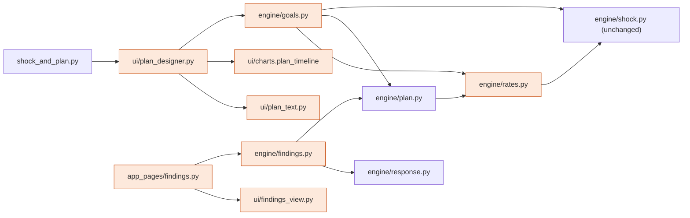

# Engineering note: J5 plan designer, loan end, Findings, and review fixes R1 to R22

Status: 2026-11-08, software-engineer lead. Design: [`j5_plan_designer.md`](j5_plan_designer.md) (frozen §3). Build plan: [`j5_plan_designer_build.md`](j5_plan_designer_build.md). Brief: [Parts 1 to 8](../briefs/plan_designer_brief.md). This note covers only how the build is split and run. It decides no behaviour.

## Diagrams

The design already holds the required diagrams, and the build follows them:

- part of the system: [design §2 flowchart](j5_plan_designer.md#2-design-model-software-system-architecture), with layers UI, wording, chat and engine, and the new nodes `rates`, `goals`, `findings`, `plan_text`, `findings_view`, `plan_designer` and `app_pages/findings`;
- component diagram: [design §2 classDiagram](j5_plan_designer.md#2-design-model-software-system-architecture), with the `rates` and `goals` namespaces, `BackupPlan` and `GoalPlan`;
- interaction model: [design §6](j5_plan_designer.md#6-interaction-model), with the collaborations "J5.1 Plan a savings goal", "J5.2 Plan time off work", "J5.3 Budget for an emergency", "J5.4 Read the combined timeline", "J3 Make a plan (loan end)" and "Show the biggest finding", and sequences 6.1 to 6.3. This project keeps them in `docs/architecture/`, not in a separate collaborations folder (the project layout overrides the default).

## Code map

| Path | One responsibility | Layer | WP |
| :-- | :-- | :-- | :-- |
| `app/engine/rates.py` | Three saving rates, `loan_end`, `duration_with_loan_end` | engine | E1 |
| `app/engine/plan.py` | `GoalAtRate` (D7), `LoanEndCheck` (ADR 0006), D8 step words | engine | E1 |
| `app/engine/goals.py` | `design_plan` projection, `wallets_at` | engine | E2 |
| `app/engine/response.py`, `findings.py` | One income-drop pass; F1 to F6 | engine | F |
| `app/ui/text.py` | R1, R4, R10, R11/R21, R14, R19, R20, D5, D7 lines, loan backup line | wording | T |
| `app/ui/plan_text.py` | `P.*` sentences, markers, wallet and table rows | wording | T |
| `app/ui/findings_view.py` | `F.*` sentences, histogram | wording | F |
| `app/assistant/*`, `app/ui/cheatsheet.py` | R5 words, D2 assumed length, R6 lines | chat | C |
| `app/ui/plan_designer.py`, `charts.py`, `app_pages/shock_and_plan.py` | Region P, chart, footer, D2/D4 notes | UI | UI |
| `app/app_pages/findings.py`, `streamlit_app.py` | Fourth page | UI | F |

**Dependency direction:**

- pages → `app.ui` → `app.engine`;
- inside the engine: `goals` → `plan` → `rates` → `shock` → `profile` → `formulas`;
- `findings` → `response`, `plan`, `profile`, `shock`, `data`;
- nothing in `app/engine/` or `app/assistant/` imports Streamlit, and nothing in `app/assistant/` imports the network or a language model (D1 to D6, plus E1 to E5 checked in `test_chat_imports.py`).

## Decisions taken here (structure only)

- **T0 by the lead:**
  - every frozen dataclass of design §3 verbatim, with stubs;
  - `test_judges_parity.py` (4,500 × 13 shocks + R15, 19 tests, about 66 s);
  - `P` holds the copy §11 rows literally.
- **One deviation from "T0 has no behaviour":** `rates.loan_end` and the per-rate bumps (LE-1 to LE-4) are real in T0. They are fully settled (Part 7 to the cent), and doing them now removes the E1 → E2 wait on the critical path. Checked against 95548, 60630, 66505 and 20111, plus the populations (448; 60/125/235/335; 197 → 197/197/166/29/2; 156; 45).
- **Shared tree, no worktrees.** The owner asked for nothing to be committed, so the packages edit one tree with disjoint ownership. Each developer runs only its own test files while the others are working. The lead runs the full suite.
- **Pattern:** the same functional core with a thin shell as ADR 0003. The force is that the 4,500-account sweeps must run without Streamlit, and the chat must be able to call `design_plan` later. No strategy layer for the rates, because there are exactly three.

## Traps found in the code

- `plan._steps` lean step: `from_orders + from_lean = flexible - lean_above + from_orders` when other standing orders exist (95548: orders $1,413, lean $1,259, while `lean_cut` = $1,259). Build §2's test "lean cut equals orders + lean_months" holds only when there are no other orders. Assert `lean_cut == lean_months.monthly_saving` where that step exists. E1 reports this to the architect; the backup isn't changed.
- `formulas.money` and `text.money` are different functions. R22 is `formulas.money`.
- `apply_shock` falls back to `cut.months` when `through_months` is None, so R17 spies must record the kwarg itself.
- `loan_payments` differs from `monthly_payment` by cents. Count `paid_rows`; don't compare equality (lessons 2026-11-08).

## Test strategy

- Engine rules get unit tests on the real fixture IDs: 20111, 32078, 20134, 49637, 21271, 49900, 32179, 95548, 60630 and 66505.
- Population sweeps live in engine tests, with no `slow` marker (NEW-SCOPE-6).
- AppTest only for the page states in build §2.
- Deterministic: the CSVs are read-only, there's no clock or random, and the caches are per process.
- Full sentences are asserted at the call site.

## Conventions

- Money through `text.money`.
- "(ours)" on every new figure.
- `months_word` for singulars (NEW-COPY-9).
- `InvalidPlanError(field)` for bad input (`errors.py`).
- No personal data is logged. There is no logging at all.

## Tasks

| Task | WP | Owns | Depends on | Status |
| :-- | :-- | :-- | :-- | :-- |
| J5.WP-0.T0 | lead | T0 files, `test_judges_parity.py` | none | done |
| J5.WP-E1.T1 | E1 | `rates.py` (beyond `loan_end`), `plan.py`, `profile.py` (R13), `formulas.py` (R22); `test_rates`, `test_loan_end`, `test_plan`, `test_qa_gaps`, `test_account_id`, `test_sweep` | T0 | passed review |
| J5.WP-E2.T1 | E2 | `goals.py`; `test_goals`, `test_plan_designer_sweep` | T0 (`rates` real) | passed review |
| J5.WP-T.T1 | T | `text.py`, `plan_text.py` (bodies); `test_text_fixes`, `test_plan_text`, `test_ui` | T0 | passed review |
| J5.WP-C.T1 | C | `assistant/parse.py`, `state.py`, `replies.py`, `flow.py` (kwarg), `chat_text.py`, `ui/cheatsheet.py`, `docs/design/ux/chat_parser.md`; `test_chat_*`, `test_cheatsheet` | T0, T (`oneoff_line`, `after_line`) | passed review |
| J5.WP-F.T1 | F | `response.py`, `findings.py`, `ui/findings_view.py`, `app_pages/findings.py`, `streamlit_app.py`; `test_findings`, `test_findings_ui`, `test_warm_up` | T0 | passed review |
| J5.WP-UI.T1 | UI | `shock_and_plan.py`, `ui/plan_designer.py`, `ui/charts.py`; `test_plan_designer_ui`, `test_call_sites_ui` | E2, T | passed review |
| J5.WP-D.T1 | D | `project_dev-post.md`, `app/README.md`, root `requirements.txt`, `app/.streamlit/config.toml`, `scope.md` (counts, OI-15); `test_submission` | final count | dispatched last |

## Review log (2026-11-08)

- E1, E2 and T were cut off by an API limit and resumed from their files on disk with resume briefs; no work was lost or duplicated.
- Seam ruling: `plan_text.goal_lines(design, goal)` takes the `GoalResult`. The lead fixed the call in `ui/plan_designer.py` and three asserts in `test_plan_designer_ui.py`.
- Ruling: `GoalResult.fund_needed` is 0 when `fund_target` is None (S <= 0); the deficit stays in `DeadlineAnswer.need` (E2).
- The lead updated `test_profile.py`'s stale case `20111.0 -> not_digits`, which R13 reverses, to `20111.5`.
- Lean-cut trap confirmed (E1): `lean_cut` equals the `lean_months` saving except on 22286, 26699 and 36427, where other orders exceed `lean_above`. The backup is unchanged; this goes to the architect.
