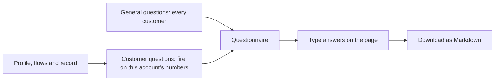

# Customer profiling

The app's second page. It shows everything on file for one customer and gives you questions to ask the stakeholder, with room for their answers. The customer picked on either page stays selected on both.

## What the page shows

| Tab | Contents |
| :-- | :-- |
| Who they are | Account details, the judges' numbers, home and branch district facts, people and cards, all notes |
| Money in and out | Typical, average and total months side by side, a pie of where money in went, two stacked columns for each month, actual changes, last 6 months against all months, sources of money in, items of money out |
| Balance | Buffer, latest balance, lowest balance, months below zero, balance chart |
| Costs and loan | Fixed costs, loan details, standing orders |
| Month by month | Money in and out chart, and every `monthly_summary` column |
| Stakeholder questions | The questionnaire below |

`transactions.csv` isn't shown. The monthly rows summarise it, and the engine doesn't load it.

## How the questions are chosen

Each question says why we ask, quoting the customer's numbers, and what the answer would change.

| Question ID | Fires when |
| :-- | :-- |
| `lumpy_income` | The 5 largest months hold at least twice their even share of money in |
| `cash_income`, `pension_income`, `high_flow`, `irregular_income`, `irregular_spending` | The note with the same meaning is on the account |
| `transfer_income` | Income type is Transfers |
| `gap_vs_actual` | S is above I, and the balance fell by less than half that gap, or rose, over the last 12 months |
| `surplus_not_kept` | I is above S, and the balance didn't grow over the last 12 months |
| `bills_missing`, `no_bills`, `leasing` | Standing orders and transactions disagree, or no bills show |
| `buffer_vs_latest` | The buffer is over 25% above the latest balance |
| `no_buffer`, `overdraft` | The buffer is at or below 0, or the balance went below zero in the last 6 months |
| `loan_status`, `recent_loan`, `finished_loan`, `missed_payment`, `thin_low_point` | The note with the same meaning is on the account |
| `lender_pause` | A loan is running |
| `out_of_date`, `little_activity` | The note with the same meaning is on the account |
| `second_person` | More than one person is on the account |
| `near_retirement` | The customer is 60 or over with no pension income |

General questions cover outside accounts, the fund target, income after EI, EI eligibility, limits on advice, age and gender, what deposit drops mean, and December 2025 spending.

## Limits

- Answers stay in the browser session. They survive switching pages and customers, but not closing the page, so download them to keep them.
- Answers don't change any number. If one changes how a plan should work, that's a separate decision.
- Gender and age are shown because they're on file. No plan or runway uses gender, and age only prompts a question.
