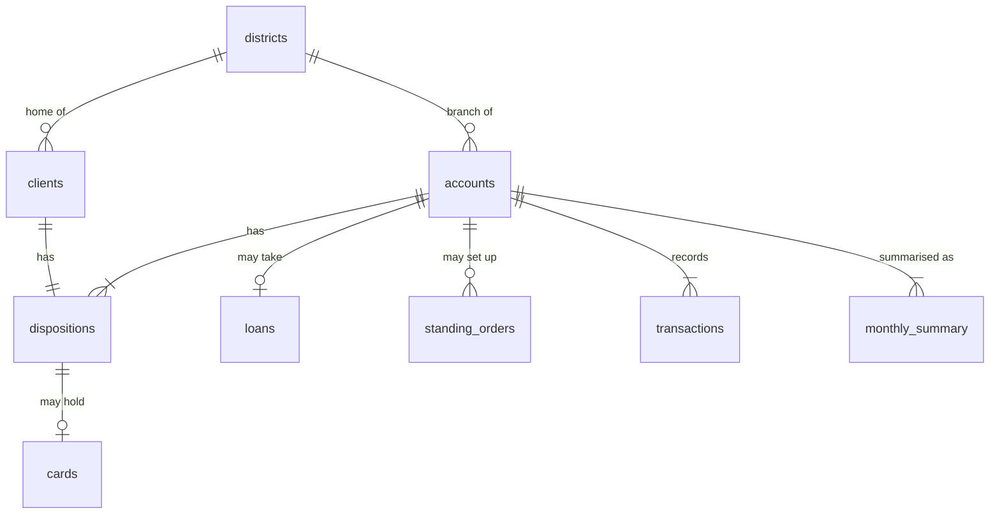

# Data model

The nine CSV files in `data/`: their columns, types, keys and relationships.

- **Sample** is the value in the file's second line (its first data row).
- **Type** is a logical type. It starts from the sample, then is checked against every row, because a single row can leave a type blank or suggest the wrong one.
- **Blanks** is the number of rows with an empty value.
- **Meaning** comes from the data dictionary in [`README.md`](../README.md) and the values in the files, except where a section says it's inferred from the column name.
- All money columns are in Canadian dollars.

What the data shows about customers is in [`discovery.md`](discovery.md).

## Tables

| Table | Rows | Grain | Primary key |
| :-- | --: | :-- | :-- |
| `districts` | 77 | One district | `district_id` |
| `accounts` | 4,500 | One account | `account_id` |
| `clients` | 5,369 | One client | `client_id` |
| `dispositions` | 5,369 | One client's role on one account | `disposition_id` |
| `cards` | 892 | One card | `card_id` |
| `loans` | 682 | One loan | `loan_id` |
| `standing_orders` | 6,471 | One standing order | `order_id` |
| `transactions` | 1,056,320 | One transaction | `transaction_id` |
| `monthly_summary` | 185,326 | One account in one month | `account_id`, `month` |

## Relationships

| Child column | Parent column | Cardinality (parent to child) | Observed |
| :-- | :-- | :-- | :-- |
| `accounts.district_id` | `districts.district_id` | 1 to many | All 77 districts have accounts |
| `clients.district_id` | `districts.district_id` | 1 to many | All 77 districts have clients |
| `dispositions.account_id` | `accounts.account_id` | 1 to 1 or more | Every account has exactly one `owner`; 869 `authorized user` rows make up the rest |
| `dispositions.client_id` | `clients.client_id` | 1 to 1 | Every client has exactly one disposition, so one account |
| `cards.disposition_id` | `dispositions.disposition_id` | 1 to 0 or 1 | 892 of 5,369 dispositions have a card |
| `loans.account_id` | `accounts.account_id` | 1 to 0 or 1 | 682 of 4,500 accounts have a loan |
| `standing_orders.account_id` | `accounts.account_id` | 1 to 0 or more | 3,758 of 4,500 accounts have a standing order |
| `transactions.account_id` | `accounts.account_id` | 1 to 1 or more | All 4,500 accounts have transactions |
| `monthly_summary.account_id` | `accounts.account_id` | 1 to 1 or more | All 4,500 accounts have monthly rows |

All nine relationships are clean: no child value is missing from its parent.

`to_account` and `partner_account` are account numbers at other banks, not foreign keys to `accounts`.

## Columns

### `districts`

These are the bank's original regions. The README only names most of these columns, so their meanings are **inferred from the names**. It defines `average_salary` and the district 69 gap. The unit of the unemployment rates isn't stated.

| Column | Type | Key | Blanks | Sample | Meaning |
| :-- | :-- | :-- | --: | :-- | :-- |
| `district_id` | INTEGER | PK | 0 | `1` | District |
| `district_name` | VARCHAR(19) | | 0 | `Hl.m. Praha` | District name |
| `region` | VARCHAR(15) | | 0 | `Prague` | One of 8 regions |
| `inhabitants` | INTEGER | | 0 | `1204953` | Population |
| `municipalities_under_500` | INTEGER | | 0 | `0` | Municipalities with under 500 inhabitants |
| `municipalities_500_1999` | INTEGER | | 0 | `0` | Municipalities with 500 to 1,999 inhabitants |
| `municipalities_2000_9999` | INTEGER | | 0 | `0` | Municipalities with 2,000 to 9,999 inhabitants |
| `municipalities_over_10000` | INTEGER | | 0 | `1` | Municipalities with over 10,000 inhabitants |
| `num_cities` | INTEGER | | 0 | `1` | Number of cities |
| `urban_ratio_pct` | DECIMAL(4,1) | | 0 | `100.0` | Urban share of inhabitants, as a percentage |
| `average_salary` | DECIMAL(12,2) | | 0 | `7891.68` | Average monthly salary (CAD) |
| `unemployment_rate_2022` | DECIMAL(4,2) | | 1 | `0.29` | 2022 unemployment rate. Blank for district 69 |
| `unemployment_rate_2023` | DECIMAL(4,2) | | 0 | `0.43` | 2023 unemployment rate |
| `entrepreneurs_per_1000` | INTEGER | | 0 | `167` | Entrepreneurs per 1,000 inhabitants |
| `crimes_2022` | INTEGER | | 1 | `85677` | Crimes in 2022. Blank for district 69 |
| `crimes_2023` | INTEGER | | 0 | `99107` | Crimes in 2023 |

### `accounts`

| Column | Type | Key | Blanks | Sample | Meaning |
| :-- | :-- | :-- | --: | :-- | :-- |
| `account_id` | INTEGER | PK | 0 | `20111` | Account |
| `district_id` | INTEGER | FK | 0 | `29` | Branch district |
| `frequency` | VARCHAR(32) | | 0 | `monthly statement` | Statement frequency: `monthly statement`, `weekly statement`, `statement after each transaction` |
| `account_opened` | DATE | | 0 | `2022-11-29` | Date opened. Always the date of the account's first transaction |

### `clients`

| Column | Type | Key | Blanks | Sample | Meaning |
| :-- | :-- | :-- | --: | :-- | :-- |
| `client_id` | INTEGER | PK | 0 | `1005803` | Client |
| `gender` | CHAR(1) | | 0 | `M` | `M` or `F` |
| `birth_date` | DATE | | 0 | `2002-06-17` | Date of birth |
| `district_id` | INTEGER | FK | 0 | `1` | Home district. Differs from the account's branch district for 409 of 4,500 owners |

### `dispositions`

Links clients to accounts.

| Column | Type | Key | Blanks | Sample | Meaning |
| :-- | :-- | :-- | --: | :-- | :-- |
| `disposition_id` | INTEGER | PK | 0 | `1002130` | Disposition |
| `client_id` | INTEGER | FK | 0 | `6856613` | Client |
| `account_id` | INTEGER | FK | 0 | `62236` | Account |
| `type` | VARCHAR(15) | | 0 | `owner` | `owner` or `authorized user` |

### `cards`

| Column | Type | Key | Blanks | Sample | Meaning |
| :-- | :-- | :-- | --: | :-- | :-- |
| `card_id` | INTEGER | PK | 0 | `100296` | Card |
| `disposition_id` | INTEGER | FK | 0 | `6499080` | Disposition that holds the card. All 892 are owners; no authorized user has a card |
| `card_type` | VARCHAR(7) | | 0 | `classic` | `junior`, `classic` or `gold` |
| `issued` | DATE | | 0 | `2023-04-20` | Date issued |

### `loans`

| Column | Type | Key | Blanks | Sample | Meaning |
| :-- | :-- | :-- | --: | :-- | :-- |
| `loan_id` | INTEGER | PK | 0 | `103082` | Loan |
| `account_id` | INTEGER | FK | 0 | `55447` | Account that took the loan |
| `loan_start` | DATE | | 0 | `2025-04-02` | Date granted |
| `amount` | DECIMAL(12,2) | | 0 | `175611.84` | Loan size: `duration_months` × `monthly_payment` |
| `duration_months` | INTEGER | | 0 | `48` | Length in months: 12, 24, 36, 48 or 60 |
| `monthly_payment` | DECIMAL(12,2) | | 0 | `3658.58` | Scheduled monthly payment. Actual payments can differ slightly; see the data notes |
| `status` | CHAR(1) | | 0 | `C` | `A`, `B`, `C` or `D` |
| `status_meaning` | VARCHAR(30) | | 0 | `running, OK so far` | A = `finished, repaid`; B = `finished, NOT repaid (default)`; C = `running, OK so far`; D = `running, client in debt` |
| `defaulted` | INTEGER (0 or 1) | | 0 | `0` | 1 if status is B or D, 0 if A or C |

### `standing_orders`

An undated snapshot taken at the end of the data. An order doesn't prove the payment is still owed; see the data notes.

| Column | Type | Key | Blanks | Sample | Meaning |
| :-- | :-- | :-- | --: | :-- | :-- |
| `order_id` | INTEGER | PK | 0 | `842974` | Standing order |
| `account_id` | INTEGER | FK | 0 | `20111` | Paying account |
| `to_bank` | CHAR(2) | | 0 | `WX` | Receiving bank code |
| `to_account` | INTEGER | | 0 | `75490885` | Account number at the receiving bank |
| `amount` | DECIMAL(12,2) | | 0 | `2330.06` | Payment amount |
| `purpose` | VARCHAR(15) | | 1,379 | `loan payment` | `household bills`, `insurance`, `leasing` or `loan payment`. Blank = other |

### `transactions`

| Column | Type | Key | Blanks | Sample | Meaning |
| :-- | :-- | :-- | --: | :-- | :-- |
| `transaction_id` | INTEGER | PK | 0 | `17672059` | Transaction |
| `account_id` | INTEGER | FK | 0 | `74958` | Account |
| `date` | DATE | | 0 | `2020-01-01` | Date, from 2020-01-01 to 2025-12-31 |
| `direction` | VARCHAR(17) | | 0 | `credit (money in)` | `credit (money in)` or `debit (money out)` |
| `operation` | VARCHAR(29) | | 0 | `cash deposit` | `cash deposit`, `cash withdrawal`, `card withdrawal`, `transfer in from another bank`, `transfer out to another bank`, `bill payment`, `bank fee` or `interest` |
| `purpose` | VARCHAR(35) | | 535,314 | (blank) | `household bills`, `insurance`, `loan payment`, `pension`, `interest credited`, `statement fee` or `penalty interest (negative balance)`. Blank = not labelled |
| `amount` | DECIMAL(12,2) | | 0 | `629.27` | Amount, never negative. The README says always positive, but 14 rows are 0 |
| `signed_amount` | DECIMAL(12,2) | | 0 | `629.27` | Positive = money in, negative = money out |
| `balance` | DECIMAL(12,2) | | 0 | `629.27` | Balance after the transaction. Rows within a day are not in time order |
| `partner_bank` | CHAR(2) | | 782,812 | (blank) | Other bank's code, on transfers only. Blank on one transfer: transaction `60712038` |
| `partner_account` | INTEGER | | 760,931 | (blank) | Account number at the other bank. 0 on another 21,881 rows, all with no `partner_bank` |

### `monthly_summary`

Derived from `transactions`: one row per account per month, from the account's first transaction month to its last, including quiet months. Balances are end-of-day balances, carried forward on days with no activity. In an account's first month, `min_balance` and `avg_daily_balance` count from its first transaction.

| Column | Type | Key | Blanks | Sample | Meaning |
| :-- | :-- | :-- | --: | :-- | :-- |
| `account_id` | INTEGER | PK, FK | 0 | `20111` | Account |
| `month` | CHAR(7) (`YYYY-MM`) | PK | 0 | `2022-11` | Month, from 2020-01 to 2025-12 |
| `money_in` | DECIMAL(12,2) | | 0 | `503.42` | Total money in |
| `money_out` | DECIMAL(12,2) | | 0 | `0.0` | Total money out, as a positive number |
| `cash_deposits` | DECIMAL(12,2) | | 0 | `503.42` | Part of `money_in` |
| `transfers_in` | DECIMAL(12,2) | | 0 | `0.0` | Part of `money_in`, excluding pensions |
| `pension_in` | DECIMAL(12,2) | | 0 | `0.0` | Part of `money_in` |
| `interest_in` | DECIMAL(12,2) | | 0 | `0.0` | Part of `money_in` |
| `household_bills` | DECIMAL(12,2) | | 0 | `0.0` | Part of `money_out` |
| `insurance` | DECIMAL(12,2) | | 0 | `0.0` | Part of `money_out` |
| `loan_payments` | DECIMAL(12,2) | | 0 | `0.0` | Part of `money_out` |
| `bank_fees` | DECIMAL(12,2) | | 0 | `0.0` | Part of `money_out` |
| `cash_withdrawals_genuine` | DECIMAL(12,2) | | 0 | `0.0` | Part of `money_out`: all cash withdrawals. Despite the name, nothing is filtered out |
| `card_withdrawals` | DECIMAL(12,2) | | 0 | `0.0` | Part of `money_out` |
| `transfers_out_other` | DECIMAL(12,2) | | 0 | `0.0` | Part of `money_out`: unlabelled transfers out |
| `month_end_balance` | DECIMAL(12,2) | | 0 | `503.42` | End-of-day balance on the month's last day. Can be negative |
| `min_balance` | DECIMAL(12,2) | | 0 | `503.42` | Lowest end-of-day balance in the month. Can be negative |
| `avg_daily_balance` | DECIMAL(12,2) | | 0 | `503.42` | Average end-of-day balance in the month. Can be negative |
| `days_below_zero` | INTEGER | | 0 | `0` | Days ending with a negative balance. See the loading notes |

## Loading notes

- **`monthly_summary.days_below_zero` has mixed formats.** 6,387 rows write the value as a decimal, such as `0.0` or `4.0`. All of them are whole numbers, so cast the column to integer.
- **`transactions.partner_account` needs a nullable integer type.** It has blanks, so a plain integer type fails, and some loaders turn it into a float.
- **`transactions.partner_account` has two "no value" forms:** blank and `0`. Treat both as no partner account.
- **`partner_bank` and `to_bank` are text.** Each holds 2-letter codes, 13 in all.
- **The README diagram leaves out one link.** `clients.district_id` also points to `districts`.
- **District 69 has gaps.** Its `unemployment_rate_2022` and `crimes_2022` are blank, so any rate or ratio using them needs a fallback.

## How `operation` and `purpose` combine

Use `purpose` to find bills, insurance and loan payments. The `bill payment` operation covers only 2,834 of the 136,565 household bill and insurance payments, and the rest are transfers out.

| `operation` | `purpose` | Direction | Rows |
| :-- | :-- | :-- | --: |
| `cash deposit` | (blank) | Credit | 156,743 |
| `interest` | `interest credited` | Credit | 183,114 |
| `transfer in from another bank` | (blank) | Credit | 34,888 |
| `transfer in from another bank` | `pension` | Credit | 30,338 |
| `cash withdrawal` | (blank) | Debit | 274,675 |
| `card withdrawal` | (blank) | Debit | 8,036 |
| `bank fee` | `statement fee` | Debit | 155,832 |
| `bank fee` | `penalty interest (negative balance)` | Debit | 1,577 |
| `bill payment` | `household bills` | Debit | 2,811 |
| `bill payment` | `insurance` | Debit | 23 |
| `transfer out to another bank` | `household bills` | Debit | 115,254 |
| `transfer out to another bank` | `insurance` | Debit | 18,477 |
| `transfer out to another bank` | `loan payment` | Debit | 13,580 |
| `transfer out to another bank` | (blank) | Debit | 60,972 |

## README rules checked against the data

| Rule | Result |
| :-- | :-- |
| `money_in` and `money_out` equal the sum of their parts | Holds on all rows, to within $0.02 |
| Every `monthly_summary` flow column rebuilds from `transactions` | Holds on all rows, to within $0.015 |
| Months run from first to last transaction with no gaps | Holds for all 4,500 accounts |
| `amount` = `duration_months` × `monthly_payment` | Holds on all 682 loans |
| `status`, `status_meaning` and `defaulted` agree | Holds on all 682 loans |
| Status C and D are the loans running at the end of 2025 | All 448 are scheduled past 2025, and all 234 A and B loans end by then |
| One loan per account | Holds |
| Balance columns rebuild from `transactions` | Holds to within $0.01, except 4 values on account 21101 (March and April 2025), off by up to $0.12. That may come from the rebuild picking the wrong row for a day |
| `amount` is always positive | **Doesn't hold:** 14 rows are 0 (10 penalty interest, 4 interest) |
| Partner fields are filled on transfers | **One exception:** transaction `60712038`, a loan payment on account 85080 |

## Data notes

**Balances**

- Use the `balance` column, not a running total of `signed_amount`. Rounding makes the two drift apart, by a median of $0.13 and up to $1.60 by an account's last day.
- Rows within a day aren't in time order. To find a day's closing balance, pick the row closest to the previous day's closing balance plus that day's net movement.

**Loans and standing orders**

- 6,182 of 13,580 actual monthly loan payments differ from `monthly_payment`, by up to $5.04.
- 323 of 682 matching standing orders differ from `monthly_payment`, by up to $0.32.
- Don't use a standing order to decide whether a loan payment is owed. 234 `loan payment` orders belong to finished loans.
- Another 35 `loan payment` orders are on accounts with no loan row and no loan payments.
- 12 running loans made no payment in the last month: 11 with status D and 1 with status C.

**Bills and leasing on standing orders**

- `household_bills` can miss real bills. 279 of the 3,502 `household bills` orders have matching transfers with no `purpose` label, at a median of $986. Those transfers land in `transfers_out_other`, so they still count in `money_out`.
- On 293 accounts, `household bills` orders total more than 10% above the median `household_bills`, by a median of $1,145. 162 of the 1,225 accounts with a median of 0 have such an order.
- None of the 341 `leasing` orders has a matching transfer out, so leasing may not be in `money_out` at all.

**Account history**

- Every account has at least 12 months of `monthly_summary` rows, so a 6-month buffer always has 6 rows to use.
- 76 accounts stop before December 2025, as early as August 2023. 56 of them stop in November 2025. Nothing marks these accounts as closed, and their last balances aren't zero, so their most recent months can be out of date.
- December 2025 median `money_out` is $6,313, against $7,835 to $8,653 in the three earlier Decembers. It's the last month in the data and may be incomplete. The cause isn't known.

**Empty values that can affect calculations**

| Condition | Accounts |
| :-- | --: |
| Median `money_in` is 0 | 14 |
| Median `money_out` is 0 | 77 |
| Median `household_bills` is 0 | 1,225 |
| Buffer is zero or negative | 23 |

## Fields derived for analysis

These aren't in the CSVs. They're calculated in [`discovery.ipynb`](../discovery.ipynb).

| Field | Definition |
| :-- | :-- |
| Income type | `Pension` if the account ever has `pension_in`; otherwise `Transfers` if it ever has `transfers_in`; otherwise `Cash only` |
| Running loan | `status` is C or D |
| Income drop event | `money_in` below 55% of the trailing 12-month median for at least 3 months in a row, on an account with usual spending above 0 |
| Lowest balance before a loan | Lowest `min_balance` in the last 6 months before the `loan_start` month |

The judges' runway inputs (I, F, S, B, H and P) are defined in the [README](../README.md#how-judges-calculate-the-numbers).
