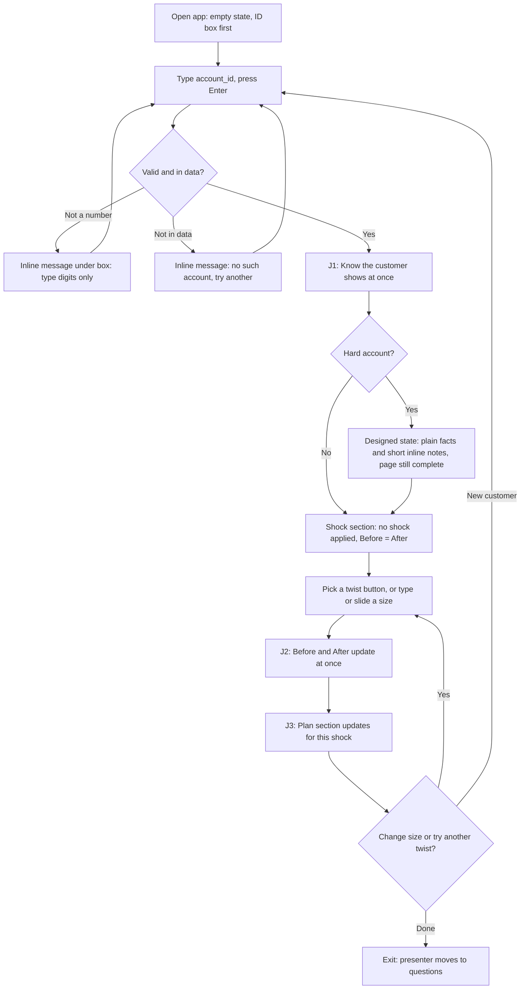
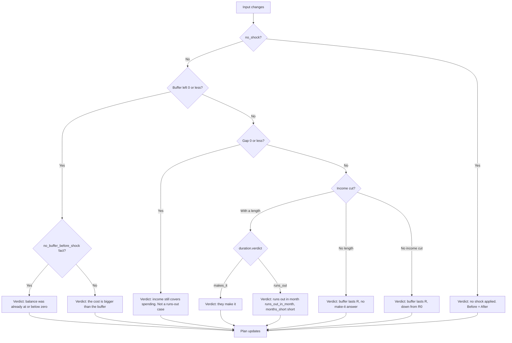
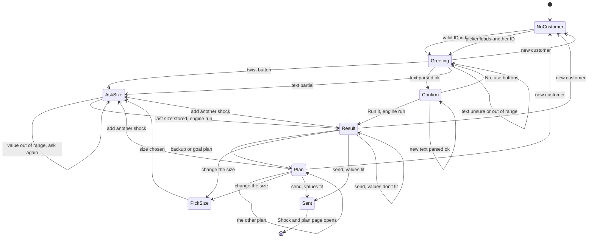

# Flows: Resilience Rewired

Status: low fidelity. Layout: no login. Sections 1 to 3 cover the Shock and plan page, with three sections stacked top to bottom (Know, Shock, Plan); section 4 covers the Chat page. Colours and type belong to the visual designer.

IDs used below: J1 = Know the customer, J2 = Take a shock, J3 = Make a plan (the three jobs in the README).

## 1. Main flow (any user, any account)

Rules for the flow
- No submit button for sliders or number boxes. Every change recalculates at once.
- The ID box keeps its value while twists change. Changing the ID resets the inputs to "no shock".
- Primary action on the empty page: "Show customer". After that the primary action is the twist buttons.

## 2. Live-twist flow (3 minutes = 180 s)

All timings below are my estimates from reading speed and click counts. Nothing has been timed on the running app (it isn't built). GO-7 in scope.md is the real measurement.

```mermaid
flowchart LR
    T0["Judge says ID and reads card"] --> T1["Type ID, Enter"]
    T1 --> T2["Read Know-the-customer line"]
    T2 --> T3["Click twist button; type any value the card changes"]
    T3 --> T4["Read verdict, then Before and After"]
    T4 --> T5["Read our numbers, or the n/a line"]
    T5 --> T6["Read goal plan"]
    T6 --> T7["Read backup plan"]
    T7 --> T8["One closing sentence, hand back"]
```

| Step | Use case | Region | Preset only | Card changes 1 value | Card changes 2 values | EI maximum on |
| :-- | :-- | :-- | --: | --: | --: | --: |
| Judge reads the card | J2 | spoken | 10 s | 10 | 10 | 10 |
| Type ID, Enter | J1 | A | 10 | 10 | 10 | 10 |
| Read the customer line and four numbers | J1 | B | 20 | 20 | 20 | 20 |
| Click the twist button | J2 | C | 5 | 5 | 5 | 5 |
| Type values the preset lacks (about 6 s each; the toggle about 4 s) | J2 | C | 0 | 6 | 12 | 16 |
| Read verdict and Before/After | J2 | D | 30 | 30 | 30 | 30 |
| Read our numbers (n/a reads in about 10 s, a figure in 25 s) | J1, J2 | E | 25 | 25 | 25 | 35 |
| Read goal plan | J3 | F | 25 | 25 | 25 | 25 |
| Read backup plan | J3 | G | 20 | 20 | 20 | 20 |
| Closing sentence | all | footer | 10 | 10 | 10 | 10 |
| **Total (estimate)** | | | **155 s** | **161 s** | **167 s** | **181 s** |

Reading of the table
- A preset, one changed value, or two fit in 3:00 with 13 to 25 s spare. These are estimates, not measurements.
- With the EI maximum on, the estimate is 181 s, a second over. Plan to drop the closing sentence (then 171 s) or read E in 20 s.
- Typing is the new cost. Each manual value is one click, the number, then Tab. The slider is for showing size, the box for exact values.
- If the judge changes three or more values, drop the closing sentence and the goal plan's second line.

## 3. Shock flow detail

The UI never decides the verdict. It reads `verdict_case`, which the engine checks in this order.

The assumption line ("after month N we assume no income") shows only when `duration.assumption_applied`. The judges' runway is read from the engine as it is and never rounded up or compared with the length by the UI.

## 4. Chat state machine (J4)

The Chat page keeps one state in session state. Every click or typed line is one transition, and each state draws only the latest message's options (RU-19). Use cases: [J4.1 to J4.4](../../inception/use_cases_chat.md).

A changed `ss.shown_id` in any state sends the chat to `Greeting` for the new customer (RU-20). Download is open in every state except `NoCustomer`, and never changes the state.

| State | Bot shows | Options |
| :-- | :-- | :-- |
| NoCustomer | `T.no_customer` | None; the picker (A) |
| Greeting | `T.greet`, summary, range, notes, `T.pick` | `T.b_job`, `T.b_bills`, `T.b_repair`, `T.b_mix`, `T.b_type`; text box |
| AskSize: keep | `T.ask_keep` | `55%`, Other (0 to 100) |
| AskSize: months | `T.ask_months` | `6 months`, `12 months`, `Until it runs out`, Other (1 to 120) |
| AskSize: bills | `T.ask_bills` | `+15%`, Other %, Dollars a month |
| AskSize: repair | `T.ask_repair` | `1 month of spending`, Dollar amount |
| Confirm | `T.confirm` | `T.b_run`, `T.b_buttons`; text box |
| Result | `T.engine_call`, result sentences | `T.f_backup`, `T.f_goal`, `T.f_stack`, `T.f_size`, `T.f_new`, `T.f_send` |
| Plan | `T.engine_call`, plan lines | As Result, with the other plan first |
| PickSize | `T.pick_size` | One button per size in the shock |
| Sent | `T.send_ok` | None: the page changes |

Mix asks keep, months and bills in that order, matching the `job_loss_bills` preset. Kinds and fields: job loss sets `income_cut`; bills sets `bills_increase_pct` or, in dollars, `other_spending_change`; repair sets `one_off_spending_multiple` or `one_off_dollars`.
