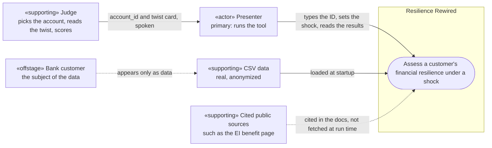

# System context

Resilience Rewired takes any `account_id` from the bank data, shows that customer's finances, applies a shock and gives a plan from their own numbers. A presenter runs it live while a judge chooses the account and the twist. The brief is in the [README](../../README.md#the-challenge), and the evidence is in [`discovery.md`](../discovery.md).

Read in this order: this page, [requirements](requirements.md), [use cases](use_cases.md), [scope](scope.md). The [glossary](glossary.md) is for reference.

**Contributors:** drafted by the inception agent. No source names the team's reviewers or area owners ([OI-9](scope.md#open-items-for-the-owner)).

| Item | Boundary | Note |
| :-- | :-- | :-- |
| Engine and Streamlit UI | Inside | [Engine API](../engine_contract.md). The UI isn't started |
| CSV data | External | [Tables](../data_model.md). The engine doesn't read `transactions.csv` |
| Public sources | External | [README list](../../README.md#canadian-sources-for-sizing-shocks). The 55% EI rate comes from the README |
| Judge | External | Doesn't touch the tool. Checks answers against [their own numbers](../../README.md#how-judges-calculate-the-numbers) |
| Bank customer | Offstage | Never uses the tool. Their interest is a plan that doesn't overclaim ([BR-10](requirements.md#bank-customer-offstage)) |

## Overview

The tool has three functional areas, one for each part of the challenge: [J1 Know the customer](use_cases.md#j1-know-the-customer), [J2 Take a shock](use_cases.md#j2-take-a-shock) and [J3 Make a plan](use_cases.md#j3-make-a-plan). The IDs come from [`flows.md`](../design/ux/flows.md).

The session runs in about [5 minutes](../../README.md#how-judging-works):

1. The presenter pitches the tool and the [biggest finding](../discovery.md#biggest-finding).
2. A judge names an account and reads a twist card.
3. The presenter runs J1, J2 and J3, reading the new numbers and the plan.
4. The judges ask questions.

Critical extensions:

- **Hard account or invalid ID:** the tool shows a designed state, and the page stays usable.
- **A card asks for a value the controls can't set:** undecided ([OI-1](scope.md#open-items-for-the-owner), [OI-6](scope.md#open-items-for-the-owner)).
- **A judge's number differs from ours:** theirs is on screen, and ours sits beside it with its reason ([RU-1, RU-2](requirements.md#business-rules)).
