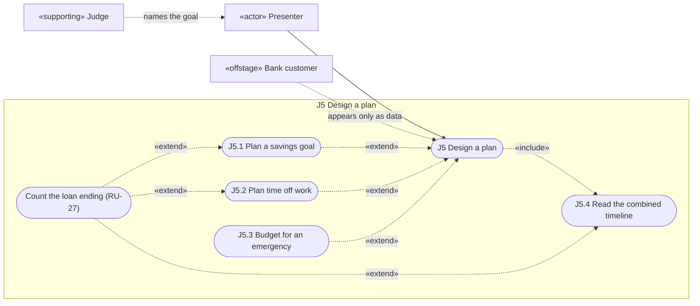

# Use cases

The actors are the same for all four: presenter (primary), judge (supporting) and customer (offstage). Sections A to H are from the [wireframes](../design/ux/wireframes.md), `K.*` and `N.*` keys are from the [copy deck](../design/ux/copy.md), and engine codes are from the [contract](../engine_contract.md). Account counts are from the [warnings table](../know_the_customer.md#warnings). "No screen" means no state is designed yet.

Drafted by the inception agent. Not yet reviewed, and no area has a named owner ([OI-9](scope.md#open-items-for-the-owner)).

## J1 Know the customer

| Field | Value |
| :-- | :-- |
| Traces to | BR-1, BR-4, BR-7, BR-8, BR-10, BR-11 |
| Rules | RU-1, RU-2, RU-3, RU-4, RU-5, RU-6, RU-9, RU-12 |
| Preconditions | App is open and `warm_up()` has run |
| Trigger | A judge names an `account_id` |
| Wireframes | [A](../design/ux/wireframes.md#a-customer-picker-always-visible-top), [B](../design/ux/wireframes.md#b-know-the-customer-j1), [E](../design/ux/wireframes.md#e-our-additions-beside-d-labelled-our-numbers-shown-next-to-the-judges), [H](../design/ux/wireframes.md#h-details-closed-stexpander) |

**Main flow**

1. The presenter types the ID and presses Enter (A).
2. The tool clears earlier results and validates the ID (A2).
3. The tool shows the header (B), `K.summary_line`, then I, S, B and runway, then H, F and P.
4. The tool shows up to 3 customer notes (B), with the rest in Details (H).
5. The tool shows our numbers, labelled, beside the judges' (E).
6. The presenter reads the summary, and the shock section opens at no shock (C1).

**Postcondition:** the customer is loaded, and the judges' numbers match the README. B includes December 2025 for most accounts (OI-3).

**Alternate flows**

| Step | Condition (accounts) | Behaviour | Screen |
| :-- | :-- | :-- | :-- |
| 2a | Not digits, such as `abc` | `K.err_not_digits`; page stays empty; retype | [A3](../design/ux/wireframes.md#a3-invalid-id-not-digits) |
| 2b | Not in the data, such as `12345` | `K.err_not_found`; retype | [A4](../design/ux/wireframes.md#a4-invalid-id-not-in-the-data) |
| 2c | Data fails to load | Not designed; checked by [GO-1](scope.md#gono-go-before-the-demo) | No screen |
| 3a | I and S both 0 (10) | `N.zero` | [B2](../design/ux/wireframes.md#b2-hard-accounts-designed-states-all-use-the-same-layout-only-these-cells-change) |
| 3b | I is 0, S isn't (4) | `N.no_income` | B2 |
| 3c | S is 0, I isn't (67) | `N.no_spend` | B2 |
| 3d | B ≤ 0 (23) | Real value shown; runway 0 months; `N.neg_buf` | B2 |
| 3e | Data stops before 2025-12 (76) | `N.stale` | B2 |
| 3f | Pension income (740) | Normal numbers; `N.pension` | B2 |
| 3g | H is 0 (1,225) | `N.no_bills` or `N.bills_gap`; E shows any standing-order bills | B2 |
| 3h | Running loan, F has $0 of it (197) | F stays as defined; `N.loan_recent` | Note in B |
| 3i | Running loan, no payment last month (12) | `N.missed` | Note in B |
| 3j | Lowest balance below 0 (105) | `N.low` | B2 |
| 4a | More than 3 notes apply | Copy deck priority; the rest go to H | [B4](../design/ux/wireframes.md#b4-long-content) |
| 5a | An addition doesn't apply | `n/a` with a reason | E |

## J2 Take a shock

| Field | Value |
| :-- | :-- |
| Traces to | BR-2, BR-4, BR-5, BR-6, BR-7, BR-8, BR-10, BR-11, BR-13 |
| Rules | RU-1, RU-2, RU-3, RU-4, RU-5, RU-6, RU-7, RU-8, RU-9, RU-10, RU-12, RU-13 |
| Preconditions | A valid customer is on screen (J1) |
| Trigger | A judge reads a twist card |
| Wireframes | [C](../design/ux/wireframes.md#c-twist-buttons-and-sliders-j2), [D](../design/ux/wireframes.md#d-before-and-after-the-judges-numbers-headline), [E](../design/ux/wireframes.md#e-our-additions-beside-d-labelled-our-numbers-shown-next-to-the-judges) |

**Main flow**

1. The presenter clicks the matching twist button, which sets all the sliders (C).
2. If the card's size differs, the presenter moves a slider (C).
3. The tool recalculates at once and shows the verdict with Before and After (D).
4. For an income cut with a length, the verdict answers "do they make it?" from `duration.verdict`.
5. The tool shows any inline facts under the verdict (D).
6. The tool updates our numbers, labelled, beside D (E).
7. The presenter reads the verdict and the difference, and J3 updates.

**Postcondition:** the judges' runway for this shock is on screen, with our figures beside it. EI applies as a share of I. The weekly maximum, if switched on, only adds a labelled second runway (OI-4).

**Alternate flows**

| Step | Condition (accounts) | Behaviour | Screen |
| :-- | :-- | :-- | :-- |
| 0a | ID invalid or missing | C to H aren't drawn; go to J1 2a or 2b | A3, A4 |
| 0b | ID changes mid-flow | Results clear and sliders reset; go to J1 step 2 | A2 |
| 1a | Reset | After equals Before | [C1](../design/ux/wireframes.md#c1-no-shock-selected) |
| 2a | Income isn't on the slider step, such as 57% | **Gated on OI-1.** The engine accepts it. Fallback: the presenter decides and says so aloud | C |
| 2b | Card gives a cost or rent rise in dollars | **Gated on OI-6.** The engine accepts it, but there's no control. Fallback as in 2a | No screen |
| 2c | Start month given | **Gated on OI-7.** Never changes runway | No screen |
| 3a | Gap ≤ 0 after the shock | `no_shortfall` | [D1](../design/ux/wireframes.md#d1-no-shortfall-after-the-shock) |
| 3b | One-off exceeds the buffer | `runway_zero`; negative buffer left shown | [D2](../design/ux/wireframes.md#d2-runway-0) |
| 3c | B was already ≤ 0 (23) | `runway_zero`; don't blame the cost (CON-5) | D2 |
| 3d | Cost or bills only | `cost_or_bills_only`; no "make it" claim | D |
| 4a | Lasts, or runs out early | `income_cut_makes_it`, or `income_cut_runs_out` with `runs_out_in_month` (CON-1) | D |
| 5a | Pension, layoff twist (740) | Applied as asked; plain line | [D3](../design/ux/wireframes.md#d3-pension-account-on-a-layoff-twist) |
| 5b | I is 0, income cut (14) | Money in stays $0; plain line | [D4](../design/ux/wireframes.md#d4-zero-income-account) |
| 5c | H is 0, bills shock (1,225) | Spending unchanged; plain line points to E | [D5](../design/ux/wireframes.md#d5-bills-shock-with-h--0) |
| 5d | Orders exceed H, bills shock (293) | Judges' number in D, larger figure in E | E |
| 5e | S is 0, one-off in months (77) | One-off is $0; `one_off_zero_spending` | No screen |
| 6a | "If you adjust" doesn't apply | `n/a` with a reason (CON-3) | E |

## J3 Make a plan

| Field | Value |
| :-- | :-- |
| Traces to | BR-3, BR-7, BR-8, BR-10, BR-11, BR-12, BR-23 |
| Rules | RU-1, RU-3, RU-4, RU-5, RU-6, RU-7, RU-8, RU-11, RU-12, RU-27, RU-28, RU-31 |
| Preconditions | A valid customer is on screen. A shock is optional |
| Trigger | The presenter reaches the plan, or a judge asks what the customer should do |
| Wireframes | [F](../design/ux/wireframes.md#f-goal-plan-emergency-fund-j3), [G](../design/ux/wireframes.md#g-backup-plan-if-the-shock-hits-j3) |

**Main flow**

1. The tool shows the goal plan on no-shock numbers, with the target slider (F). The default target is **gated on OI-5**.
2. The tool shows the plan sentence and savings path (F).
3. If a loan is running, the tool shows the one-payment line, `K.f_low` (F).
4. The tool shows the backup plan for the current shock: cut needed, share of spending, fixed costs and cuttable amount (G).
5. The tool lists the steps in order, and the presenter reads both plan sentences (G).

**Postcondition:** the customer has a goal and a backup from their own numbers. No judges' number changes.

**Alternate flows**

| Step | Condition (accounts) | Behaviour | Screen |
| :-- | :-- | :-- | :-- |
| 0a | ID invalid or missing | F and G aren't drawn; go to J1 2a or 2b | A3, A4 |
| 1a | Buffer already meets the target | `already_there`; `K.f_done` | F |
| 1b | S ≥ I | `no_surplus`; `K.f_nosurplus` | F |
| 1c | S is 0 (77) | `no_regular_spending`; `K.f_none` | F |
| 1d | B ≤ 0 (23) | First step is `K.f_negative` | F |
| 2a | Surplus isn't reaching the balance | `surplus_not_seen_in_balance` | No screen |
| 4a | No shock | `no_shock`; `K.g_none`. **The UI must pass `Shock()`**, because `shock=None` plans for a layoff | G |
| 4b | Already makes it | `no_cuts_needed`; `K.g_ok` | G |
| 4c | Cut exceeds flexible spending | `cuts_not_enough`; `K.g_floor`; no fix claimed | G |
| 4d | Buffer left ≤ 0 | `no_buffer`; `K.g_zero` (OI-11) | G |
| 4e | One-off with no length | `K.g_oneoff` | G |
| 4f | Pension (740) | Shown as normal | G |
| 5a | Running loan | `ask_lender`, marked as needing agreement | G |
| 5b | Running loan ends within the months asked (60 within 6 months) | `P.loan_backup` (ours) under the steps; the judges' runway and verdict stay. **Gated on NEW-ADR-1** (RU-28) | [G](../design/ux/wireframes.md#g-backup-plan-if-the-shock-hits-j3) |

## J4 Ask the assistant

Summary use case for the guided chat. Author: the inception agent; owner TBD (OI-9). It runs offline with no language model (RU-15), and its user-goal use cases are in [`use_cases_chat.md`](use_cases_chat.md).

| Field | Value |
| :-- | :-- |
| Traces to | BR-14, BR-15, BR-16, BR-17, BR-18 |
| Rules | RU-15, RU-17, RU-20. The rules of J4.1 to J4.4 apply in their steps |
| Preconditions | App open, `warm_up()` run, a customer loaded in the shared picker (A) |
| Trigger | The presenter opens the Chat page |
| Wireframes | [T1 to T6](../design/ux/wireframes.md#t-chat-page-j4) |

**Main flow**

1. The tool greets the customer in `ss.shown_id` with `T.greet`, `K.summary_line`, `T.range` and up to 3 notes (T2).
2. The presenter states the twist with buttons ([J4.1](use_cases_chat.md#j41-ask-a-twist-with-buttons)) or in words ([J4.2](use_cases_chat.md#j42-ask-in-free-text)).
3. The tool shows the engine call and the result sentences.
4. The presenter follows up: plan, stack, resize or send to the controls ([J4.3](use_cases_chat.md#j43-follow-up-a-result)).
5. The presenter downloads the transcript ([J4.4](use_cases_chat.md#j44-download-the-transcript)).

**Extensions**

| Step | Condition | Behaviour | Screen |
| :-- | :-- | :-- | :-- |
| 1a | No customer, or an invalid ID | `T.no_customer`; the picker shows its message | T1 |
| 1b | Warning codes apply | The first 3 of `notes(p)` in the greeting, in copy deck order | T2 |
| 1c | Short history: the shortest is 12 months (2 accounts, computed on 2026-11-07) | The data range and month count are shown. **A short-history note is gated on OI-12**; fallback: none, the presenter reads the range | T2 |
| 1d | Data stops before 2025-12 (76) | `N.stale` among the notes | T2 |
| 2a | The free text can't be read | Back to the buttons; nothing is guessed (RU-17) | T6 |
| 4a | The customer changes in the picker | The chat restarts for the new customer; the old one stays in the transcript only (RU-20) | T2 |

## J5 Design a plan

Summary use case for the plan designer at the bottom of Shock and plan. Author: the inception agent; owner TBD (OI-9). Its user-goal use cases are in [`use_cases_plan.md`](use_cases_plan.md); `P.*` keys are in [copy §11](../design/ux/copy.md#11-plan-designer-p) and screens P1 to P5 in [wireframes P](../design/ux/wireframes.md#p-plan-designer-j5).

| Field | Value |
| :-- | :-- |
| Traces to | BR-19, BR-20, BR-21, BR-22, BR-23 |
| Rules | RU-1, RU-2, RU-9, RU-11, RU-23, RU-24, RU-26, RU-27 |
| Preconditions | A valid customer is on Shock and plan (J1 1, 2) |
| Trigger | A judge asks what the customer could plan for, such as "save $60k for a car in 2 years" |

**Main flow**

1. The presenter scrolls to the plan designer (P1). The tool shows the three saving rates, the headline first (RU-23).
2. The presenter ticks one or more plans: a savings goal ([J5.1](use_cases_plan.md#j51-plan-a-savings-goal)), time off work ([J5.2](use_cases_plan.md#j52-plan-time-off-work)) or an emergency budget ([J5.3](use_cases_plan.md#j53-budget-for-an-emergency)).
3. The tool answers each ticked plan in its own panel, on no-shock numbers (RU-11).
4. The tool draws one timeline with every plan's markers, and its table view ([J5.4](use_cases_plan.md#j54-read-the-combined-timeline)).
5. The presenter reads each plan's headline line.

**Extensions**

| Step | Condition (accounts) | Behaviour | Screen |
| :-- | :-- | :-- | :-- |
| 1a | ID invalid or missing | P isn't drawn; go to J1 2a or 2b | A3, A4 |
| 1b | S is 0 (77) | No fund target: `P.no_fund`; goals count from $0 | P1 |
| 1c | Data stops before 2025-12 (76) | Month 1 is the month after the last data month: `P.month_one` | P1 |
| 1d | Short history (840 under 24 months; shortest 12) | The data range is shown. A note is **gated on OI-12**; fallback: none | P1 |
| 2a | Nothing ticked | Only the fund marker and the rates show | P1 |
| 3a | A shock is set on the page | Ignored here (RU-11): `P.no_shock_used` | P1 |
| 4a | Running loan (448), status D (45) | Payoff marker; `P.loan_d` for D (RU-27) | P5 |
| 4b | The customer changes | Ticks and inputs stay; every figure is recalculated for the new customer (RU-12) | P1 |

