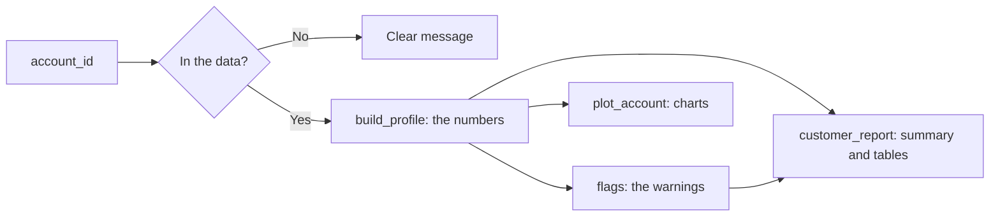

# Know the customer

Challenge requirement 1: take any `account_id` and show their income, bills and fixed costs, savings buffer, and months of runway.

The working version is [`know_the_customer.ipynb`](../know_the_customer.ipynb). This page describes its logic. The columns it uses are in [`data_model.md`](data_model.md), and the reasons for its additions are in [`discovery.md`](discovery.md).

## How it works

| Function | Job |
| :-- | :-- |
| `know_the_customer(account_id)` | Shows the full report and charts, and returns the profile |
| `build_profile(account_id)` | Calculates one account's numbers, with no display code |
| `flags(profile)` | Turns a profile into warnings |
| `customer_report(profile)` | Writes the summary and tables as Markdown |
| `plot_account(profile)` | Draws the two charts |

The shock and plan work can reuse `build_profile`, though it currently lives inside the notebook.

## The judges' numbers

These follow the [README definitions](../README.md#how-judges-calculate-the-numbers) exactly. Medians and means come from the account's rows in `monthly_summary.csv`.

| Number | Definition |
| :-- | :-- |
| Typical money in (I) | Median of `money_in` |
| Typical spending (S) | Median of `money_out` |
| Household bills (H) | Median of `household_bills` |
| Typical fixed costs (F) | Median of `household_bills + insurance + loan_payments` |
| Loan payment (P) | `monthly_payment` if the loan status is C or D, otherwise 0 |
| Buffer (B) | Mean of `avg_daily_balance` over the last 6 rows, sorted by month |

### Runway with no shock

| Condition | Runway |
| :-- | :-- |
| B ≤ 0 | 0 months |
| B > 0 and S ≤ I | No shortfall (120+) |
| Otherwise | B ÷ (S − I), capped at 120 months and rounded to 1 decimal |

## Our additions

Each one is shown next to the judges' numbers, and none replaces them.

| Number | Definition | Why |
| :-- | :-- | :-- |
| Bills on standing orders | Total of the account's `household bills` standing orders | H misses bill transfers that carry no label. The orders are an undated snapshot |
| Current fixed costs | Median of `household_bills + insurance`, plus any bills on standing orders above H, plus P | F misses recent loans and unlabelled bills, and still counts finished loans |
| Buffer in months of spending | B ÷ S, shown as n/a if B ≤ 0 or S = 0 | Runway mostly tracks money flow, so this shows savings on their own |
| Lowest balance | Lowest `min_balance` in the last 6 rows | An average hides the low point |
| Last 6 months | I, S, H and F medians over the last 6 rows | Shows when a lifetime median has gone stale. Six months can include seasonal peaks |
| Income type | `Pension` if the account ever has `pension_in`; otherwise `Transfers` if it ever has `transfers_in`; otherwise `Cash only` | `money_in` means different things on each |

## Warnings

Warnings explain when a number could mislead. Only 324 of the 4,500 accounts have none.

| Warning | Shown when | Accounts |
| :-- | :-- | --: |
| Little activity | I and S are both 0 | 10 |
| Irregular income | I is 0 and S isn't | 4 |
| Irregular spending | S is 0 and I isn't | 67 |
| Out of date | The last row is before 2025-12 | 76 |
| No buffer | B ≤ 0 | 23 |
| Pension income | Income type is `Pension` | 740 |
| Cash income | Income type is `Cash only` | 2,894 |
| High flow | I is over 2x the average salary in the owner's home district | 1,402 |
| Bills missing from H | Bills on standing orders are over H × 1.1 + $1 | 293 |
| No regular bills visible | H is 0 and bills aren't missing from H | 1,063 |
| Recent loan missed by F | The loan is running and median `loan_payments` is 0 | 197 |
| Finished loan still counted | The loan has finished and median `loan_payments` is above 0 | 79 |
| Loan in trouble | Loan status is B or D | 76 |
| Missed payment | The loan is running and the last row's `loan_payments` is 0 | 12 |
| Went negative | Lowest balance is below 0 | 105 |
| Thin low point | The loan is running and the lowest balance is from $0 up to one payment | 23 |
| Leasing not counted | The account has a `leasing` standing order | 341 |

## Worked example: account 20111

| Number | Value | Calculation |
| :-- | --: | :-- |
| I | $6,339 | Median of 38 months of `money_in` |
| S | $8,600 | Median of 38 months of `money_out` |
| H | $0 | Median of `household_bills` |
| F | $2,330 | Median of bills, insurance and loan payments |
| P | $2,330 | Loan status is D, so it's running |
| Current fixed costs | $2,330 | $0 + $0 of unlabelled bills + P |
| B | $17,612 | Mean of the last 6 `avg_daily_balance` values |
| Buffer in months of spending | 2.0 | $17,612 ÷ $8,600 |
| Monthly shortfall | $2,260 | $8,600 − $6,339 |
| **Runway** | **7.8 months** | $17,612 ÷ $2,260 |

It gets three warnings: cash income, no regular bills visible and loan in trouble.

## How it was checked

| Check | Result |
| :-- | :-- |
| Single-account numbers match a separate bulk calculation | All 4,500 accounts |
| Runway follows the README rules | All 4,500 accounts |
| Numbers match a separate calculation using only the standard library, on the raw CSVs | 5 sample accounts: 20111, 20176, 20208, 32078, 21132 |
| Warning counts match [`discovery.md`](discovery.md) | Passes when the notebook runs |
| A report builds without errors | All 4,500 accounts |
| An unknown or invalid ID gets a clear message | Tested with `12345` and `abc` |

## Known limits

- **Standing orders are undated.** A recent or ended order can skew bills on standing orders and current fixed costs.
- **Income can't be verified.** On cash-only accounts, the data can't show how much of the money coming in is pay.
- **Lifetime medians lag.** The "last 6 months" column shows recent change, but runway follows the judges' lifetime medians.
- **December 2025 may be incomplete.** It's in the buffer window for most accounts, and the cause of its low spending isn't known.
- **Leasing is flagged, not counted.** The data has no matching transfers, so it isn't added to any figure.
